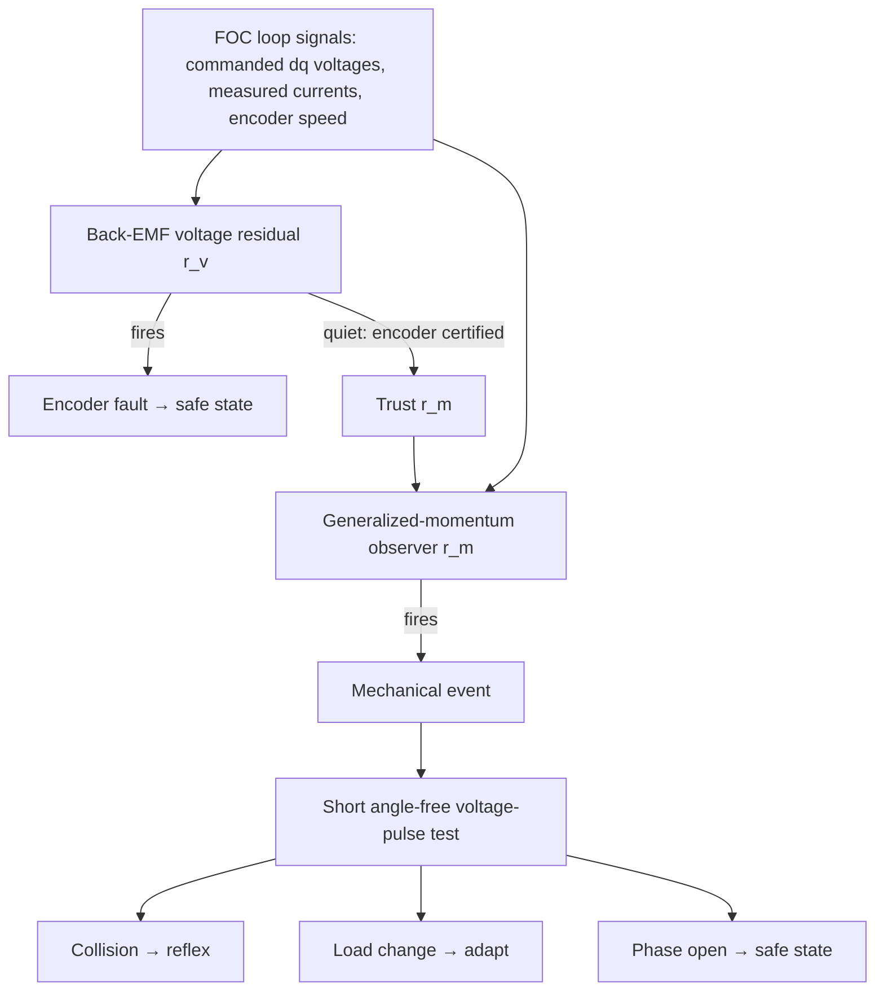

IEEE conference paper draft · Robot actuators · Nov 2026

# Isolating Sensor Faults from Mechanical Events in Robot Joint Actuators

A model-based fault detection and isolation scheme for PMSM robot joint actuators that tells sensor faults apart from collisions and payload changes, using only signals the FOC loop already computes.

Lakshanand Sugumar · Arizona State University · Work-in-progress draft (simulation results; hardware validation in progress)

PMSMFOCFault detection & isolationMomentum observerBack-EMF residual

[Read the method](method.md){ .md-button .md-button--primary } [PDF draft](https://github.com/LakshanandSugumar/actuator-fdi-paper/blob/main/main.pdf){ .md-button } [:fontawesome-brands-github: View source files](https://github.com/LakshanandSugumar/actuator-fdi-paper){ .md-button }

  
299 / 300Injected faults isolated correctly (sim)

  
≤ 0.51 msEncoder-fault detection

  
0False alarms in 1 h of normal motion

  
~3×Faster collision detection than following error

## Abstract

A joint actuator that stops on every anomaly is safe but unusable, and one that ignores anomalies is dangerous; the right reaction depends on whether the fault is in the sensor or in the mechanics. We present a model-based fault detection and isolation (FDI) scheme for permanent-magnet synchronous motor (PMSM) joint actuators that separates the two classes using only signals the field-oriented control (FOC) loop already computes. A back-EMF voltage residual, built from the commanded *dq* voltages, measured currents, and encoder speed, responds to encoder faults but is structurally insensitive to load torque. A generalized-momentum observer responds to external torque but is trusted only while the voltage residual certifies the encoder. Together with a short angle-free voltage-pulse test, the residuals isolate encoder faults, phase open circuits, collisions, and load changes, and select a class-specific reaction. In a simulation study with model errors of up to \SI{30}{\percent}, 300 Monte Carlo fault trials, and one hour of normal motion, the scheme isolated 299 of 300 faults with no false alarms. Encoder faults raised an alarm within \SI{0.51}{\milli\second} and were isolated in a median of \SI{3.5}{\milli\second}; collisions were detected in a median of \SI{2.3}{\milli\second} against \SI{7.0}{\milli\second} for a following-error check, which also raised false alarms in \SI{22}{\percent} of normal runs. \TBD{One sentence on hardware results.}

## The idea in one picture

The back-EMF residual responds to encoder faults but is structurally insensitive to load torque. The momentum observer responds to external torque, but is trusted only while the voltage residual certifies the encoder. A joint that stops on every anomaly is safe but unusable; this scheme lets it pick a reaction that fits the fault.

## Contents

-   :material-function-variant: **[Method](method.md)**

    System model, the two residuals, discrete implementation, and fault isolation and reaction.

-   :material-chart-bell-curve: **[Simulation study](results.md)**

    Encoder freeze, collision, speed sweep, 300-trial Monte Carlo, ROC and robustness.

-   :material-scale-balance: **[Discussion](discussion.md)**

    Limitations, next steps, and how to reproduce every number.

-   :material-engine-outline: **[The testbed](https://lakshanandsugumar.github.io/projects/actuator-foc-testbed/)**

    The robot-joint FOC testbed this paper builds on.

