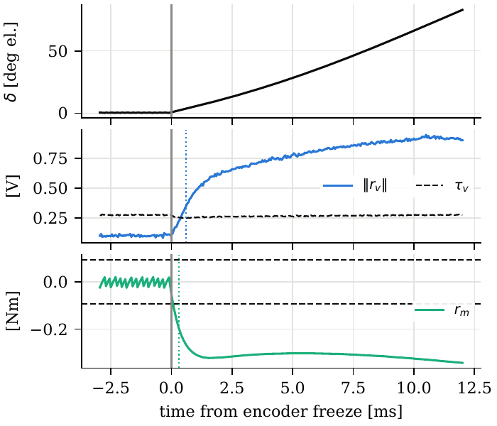
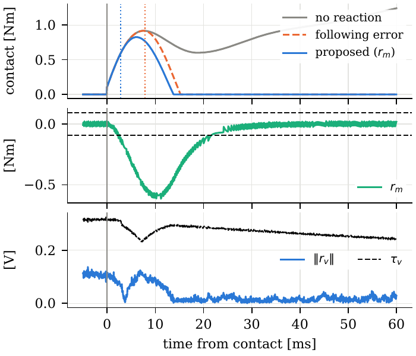
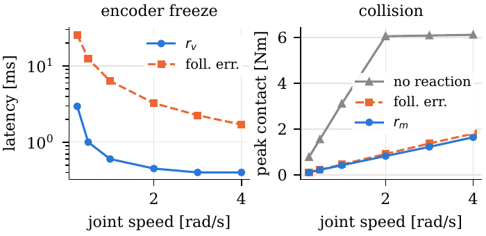

# Simulation Study

!!! info "Web version"
    This page is a web rendering of the paper draft. Citations, equation numbers and final formatting are in the [PDF](https://github.com/LakshanandSugumar/actuator-fdi-paper/blob/main/main.pdf).

## Setup

The simulation models a small quasi-direct-drive actuator (2): a surface PMSM in the stationary frame integrated at 100 kHz; a three-phase inverter with 0.1 V dead-time voltage error; a 14-bit motor-side encoder; current-sensor noise of 30 mA rms; viscous and Coulomb friction; FOC at 20 kHz with 1.5 kHz current loops; and a 10 Hz PD position loop with model feedforward, all driven by the measured encoder angle. The speed estimate is a filtered encoder difference (300 Hz). Contacts are a spring-damper obstacle (100 N m rad−1). The controller and the residuals use a model whose parameters differ from the plant by uniform random errors of up to $\pm20$ on $R$, $\pm5$ on $\lambda_m$, $\pm10$ on $J$ and $L$, and $\pm30$ on both friction coefficients, drawn anew for every run. The parameters are representative values, not identified from our testbed. 

**Thresholds** were calibrated once on 3 minutes of normal motion (sine, chirp to 4.5 Hz, and random minimum-jerk moves up to 6 rad s−1) and then frozen: $c_0=0.23$, $c_1=4.5e-4$, $c_2=0.09$, $\tau_m^\mathrm{thr}=0.093$. The baseline following-error check was calibrated the same way (1.25 times the largest value seen), giving 6.2 mrad.

| Parameter                   | Symbol        | Value                                   |
|:----------------------------|:--------------|:----------------------------------------|
| Pole pairs                  | $p$           | 14                                      |
| Phase resistance            | $R$           | 0.30 Ω                                  |
| $d$/$q$ inductance          | $L_d=L_q$     | 100 μH                                  |
| Flux linkage                | $\lambda_m$   | 6.0 mWb                                 |
| Gear ratio                  | $N$           | 6                                       |
| Joint-side inertia          | $J$           | 2.0 × 10−3 kg m2  |
| Viscous / Coulomb friction  | $b$, $\tau_c$ | 0.01 N m s rad−1, 0.05 N m   |
| Bus voltage / current limit | –             | 24 V, 8 A                               |
| Current-loop rate           | $f_s$         | 20 kHz                                  |
| Encoder resolution          | –             | 14 bit (motor side)                     |
| Observer gain               | $K$           | 200  s                                  |
| Residual filter             | $a$           | $2\pi\cdot500$ |

Simulated actuator parameters (representative, not identified)

## Silent encoder freeze

At $t=0$ the encoder output is held at its last value with no error flag while the joint cruises at 1 rad s−1 (2). The angle error $\delta$ grows with the true motion and $r_v$ crosses its threshold after 0.60 ms. The momentum residual alarms even earlier, at 0.30 ms, because the speed estimate collapses; acting on it alone would mislabel the fault as a collision. The following-error check alarms only after 6.4 ms, and it cannot say whether the sensor or the mechanics failed.

<figure markdown id="fig:sim_enc">

<figcaption>Simulated silent encoder freeze at 1 rad s−1. Top: electrical angle error. Middle: back-EMF residual and its threshold. Bottom: momentum residual and threshold. Dotted lines mark alarms.</figcaption>
</figure>

## Collision

shows an impact at 2 rad s−1. The momentum observer detects the contact 2.8 ms after impact, against 7.9 ms for the following-error check. With the proposed reaction the peak contact torque is 0.83 N m against 0.92 N m with the baseline; without any reaction the position controller keeps pushing and the contact torque rises to the current limit (6.1 N m) within 0.4 s. Throughout the collision $\|r_v\|$ stays well below $\tau_v$, confirming the load insensitivity predicted by [eq:rv].

<figure markdown id="fig:sim_coll">

<figcaption>Simulated collision at 2 rad s−1. Top: contact torque with no reaction, the following-error check, and the proposed observer. Middle: momentum residual. Bottom: back-EMF residual, which stays below its threshold.</figcaption>
</figure>

## Effect of speed

sweeps the joint speed. Encoder-freeze detection by $r_v$ takes 2.95 ms at 0.25 rad s−1 and 0.40 ms at 4 rad s−1, against 25.7 ms–1.7 ms for the following-error check. The analytic limit $|\omega_e| > c_0/(\lambda_m-c_1)$ corresponds to 0.50 rad s−1 at the joint; the freeze at 0.25 rad s−1 is still caught because the position loop, seeing no motion, accelerates the joint past that limit. Collision detection takes 12.0 ms–2.0 ms with $r_m$ and 30.5 ms–6.0 ms with the following error over the same range. The peak contact torque is dominated by the reflected inertia at impact, so faster detection lowers it only by 2 %–10 %; the main benefit of either reaction is to prevent the controller from clamping against the obstacle.

<figure markdown id="fig:sim_sweep">

<figcaption>Speed sweep. Left: encoder-freeze detection latency (log scale). Right: peak contact torque in a collision.</figcaption>
</figure>

## Monte Carlo isolation and false alarms

For each fault class we ran 50 trials with random model error, cruise speed $|\dot q|\in[0.5,4]\,$, and fault time; encoder offsets were drawn from 20 °–90 ° electrical and load steps from 0.2 N m–0.8 N m. Separately, 180 held-out normal runs of 20 s each (one hour in total) measured false alarms. summarizes the results.

| Fault | Alarm | Class | Correct | Foll. error |
|---|---|---|---|---|
| Encoder freeze | 0.27 (0.43) | 3.5 (4.3) | 49/50 | 3.1 (9.5) |
| Encoder offset | 0.22 (0.25) | 3.2 (3.2) | 50/50 | 0.22$^a$ (41/50) |
| Encoder unplug | 0.23 (0.25) | 3.2 (3.2) | 50/50 | 0.23$^a$ |
| Phase open | 1.3 (6.9) | 4.2 (9.8) | 50/50 | 67$^b$ (41/50) |
| Collision | 2.3 (4.7) | 42 (45) | 50/50 | 7.0 (10.9) |
| Load step | 1.8 (3.7) | 42 (44) | 50/50 | 8.1 (14.4) |

  
$^a$the measured position jumps, so the following error reacts at once but cannot tell a sensor jump from a real one. $^b$the position loop masks the lost torque for a long time.

Encoder faults were always detected within 0.51 ms, and collisions within 5.9 ms. The only misclassification was an encoder freeze at 0.51 rad s−1: $r_m$ alarmed first, the collision reflex removed the torque, the joint coasted to a stop below the speed at which $r_v$ can see the fault, and the event was labelled Coll. The reaction was still safe (zero torque), but the label was wrong; a check of $r_v$ when control resumes, or the pulse test, would catch it. Neither residual raised a false alarm in the held-out hour, while the following-error check, calibrated the same way, alarmed in 22 % of the normal runs; its latency figures are therefore optimistic.

**ROC.** Sweeping a common multiplier on each threshold, with positives counted as detection within 20 ms and negatives as 1-second windows of normal motion, gives an area under the curve of 0.9999 for $r_v$ on encoder faults (0.998 for the following error) and 0.9999 for $r_m$ on collisions (0.9996). At the calibrated operating point $r_v$ and $r_m$ reach 100 % true positives with no false positives, whereas the following-error check reaches 94 % on encoder faults at a 1.2 % false-positive rate.

**Robustness.** Scaling all model-error bounds by 1.5 caused no false alarms in 30 runs; scaling by 2 caused $r_m$ false alarms in 3 of 30 runs, and by 3 caused $r_v$ false alarms in 3 and $r_m$ in 5 of 30 runs. The thresholds therefore hold up to about 1.5 times the assumed parameter uncertainty, which sets how carefully $\lambda_m$, $R$, $J$, and friction must be identified on hardware.