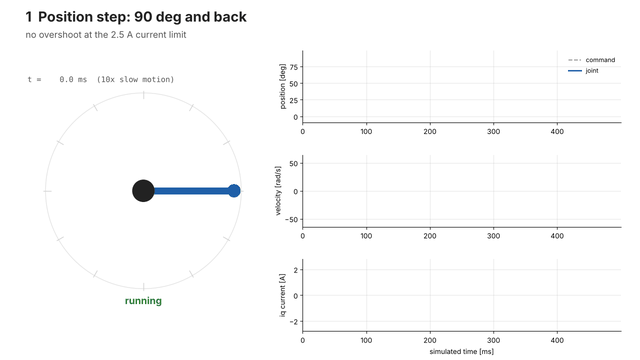
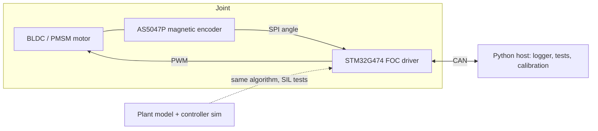

Independent project · Robot actuators · Nov 2026 – now

# Robot-Joint Actuator FOC Testbed

One robot joint built the way humanoid and legged-robot actuators are built: a brushless motor, a magnetic encoder, field-oriented control on an STM32G4, model-based fault detection and a CAN link to a Python test stack.

Simulation-first: every loop is designed and tuned in a plant model, implemented in hardware-independent C, and tested against the model before it drives a motor.

STM32G474FOCC99CANAS5047PPythonSIL testing

[See the results](results.md){ .md-button .md-button--primary } [How it works](design.md){ .md-button } [:fontawesome-brands-github: View source files](https://github.com/LakshanandSugumar/actuator-foc-testbed){ .md-button }

Simulation: the joint tracking a trajectory, rejecting a load and catching faults.

  
0.037°Sine-tracking RMS error with feedforward

  
3.3 msSilent encoder freeze caught

  
0.8 msCollision detected by momentum observer

  
67 ms90° step settle, 0% overshoot

## What it is

Humanoid and legged robots are built from compact joint actuators: a brushless motor, a reduction, an encoder and a driver running field-oriented control (FOC) tens of thousands of times a second. This testbed is one of those joints, built to study how well it can be controlled and how quickly it can tell when something goes wrong.

The stack has three layers that share one design:

| Layer | What it does |
| --- | --- |
| **Simulation** (`sim/`) | Surface-PMSM plant with sensor models, cascaded FOC controller, fault monitor and 8 experiments that regenerate every figure on this site |
| **Firmware** (`firmware/`) | Hardware-independent C99 core (FOC math, cascade, fault detectors, CAN protocol, AS5047P driver) plus STM32G474 HAL glue; unit tests and software-in-the-loop against the plant model |
| **Host** (`host/`) | python-can link with a 1 kHz logger, test profiles, encoder calibration, sim-vs-hardware comparison and a virtual joint that speaks the real protocol |

## Highlights

-   :material-sine-wave: **[Results](results.md)**

    Current, velocity and position loops, tracking, fault detection and robustness, each with its figure.

-   :material-function-variant: **[Design & Theory](design.md)**

    Plant model, loop-tuning derivations, the current-limit-aware braking curve and why the fault detectors work.

-   :material-chip: **[Firmware](firmware.md)**

    Layout, CubeMX settings, bring-up order and CPU budget for the STM32G474.

-   :material-swap-horizontal: **[CAN Protocol](can-protocol.md)**

    Every message, field and fault bit between the joint and the host.

-   :material-rocket-launch-outline: **[Getting Started](getting-started.md)**

    Run everything without hardware, then wire up and bring up the bench.

-   :material-file-document-outline: **[Fault-isolation paper](https://lakshanandsugumar.github.io/projects/actuator-fault-isolation/)**

    The IEEE paper draft that grew out of this testbed's fault detectors.

## Status

| Part | State |
| --- | --- |
| Plant model, controller, fault monitor, 8 experiments | Done, regression-tested in CI |
| Firmware core (C99) with unit and SIL tests | Done |
| STM32G474 HAL glue and CubeMX settings | Written, waiting for bench bring-up |
| Host tools and virtual joint | Done |
| Hardware results | Next: added beside the simulation results as the bench comes up |

## Want to go deeper?

Read the full write-up, browse the source, or see the rest of my work.

[:fontawesome-brands-github: View source files](https://github.com/LakshanandSugumar/actuator-foc-testbed){ .md-button .md-button--primary } [All projects](https://lakshanandsugumar.github.io/projects/){ .md-button } [Portfolio](https://www.lakshanand.dev){ .md-button }

