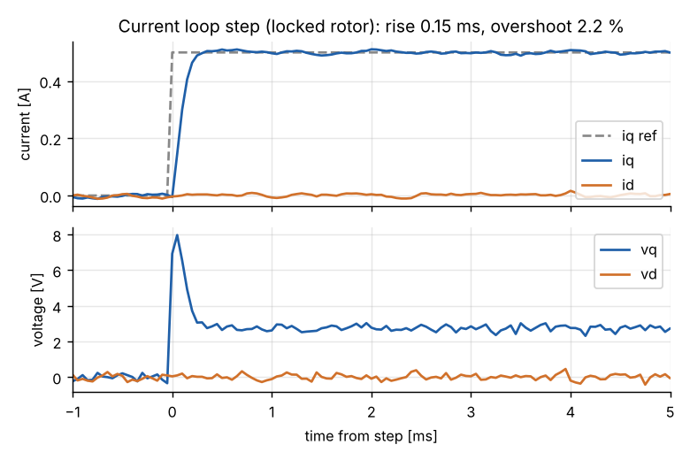
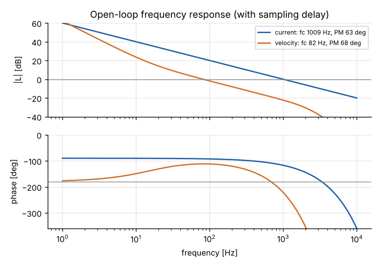
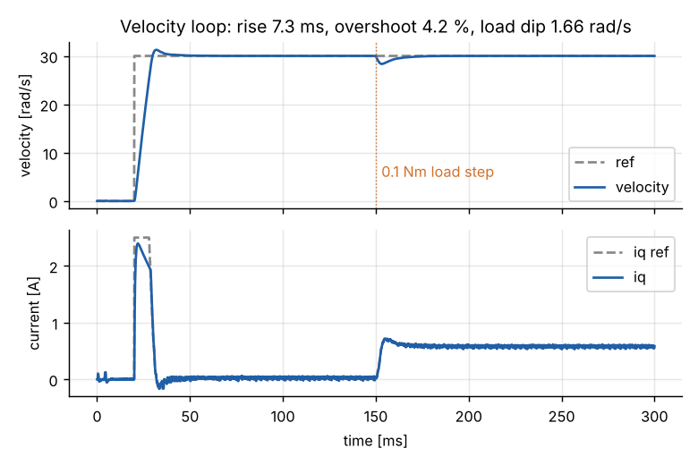
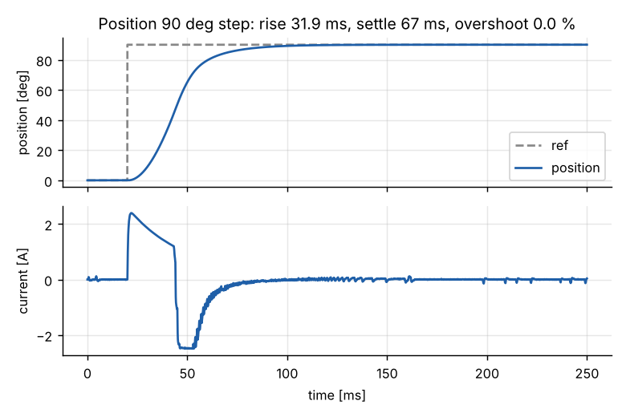
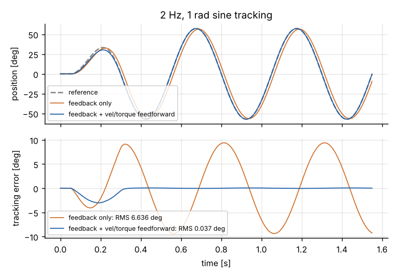
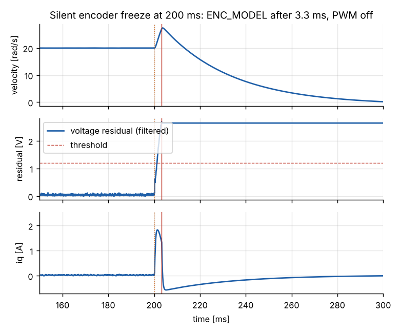
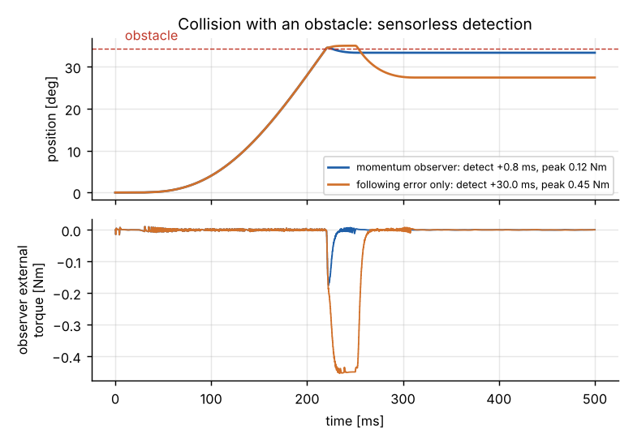
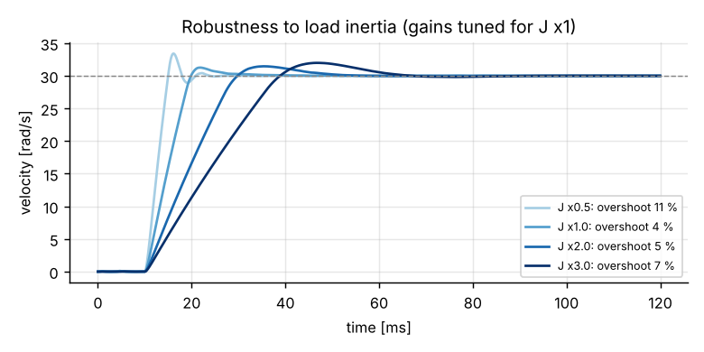

# Results

All results below are from the simulation (GM4108-class gimbal motor, 24 V bus). Every figure is regenerated by `python -m experiments.run_all`, and CI fails if a result drifts. Hardware results will be added next to these as the bench comes up.

| Test | Result | Figure |
| --- | --- | --- |
| Current loop (1 kHz design bandwidth) | 0.15 ms rise, 2 % overshoot, 63 deg phase margin with sampling delay | [01](img/01_current_step.png), [07](img/07_open_loop_bode.png) |
| Velocity loop (80 Hz) | 7.3 ms rise, 4 % overshoot, 0.1 Nm load step rejected in 11 ms | [02](img/02_velocity_step.png) |
| Position, 90 deg step | 67 ms settle, 0 % overshoot (current-limit-aware braking curve), 0.02 deg error | [03](img/03_position_step.png) |
| 2 Hz, 1 rad sine tracking | 6.6 deg RMS error with feedback only, **0.037 deg** with velocity + torque feedforward | [04](img/04_tracking_error.png) |
| Silent encoder freeze | caught by the back-EMF residual in **3.3 ms**, no error flag needed | [05](img/05_encoder_fault.png) |
| Collision with an obstacle | momentum observer detects in **0.8 ms**, 0.12 Nm peak contact torque (following-error check: 30 ms, 0.45 Nm) | [06](img/06_collision_detection.png) |
| Inertia x0.5 to x3 | stable, overshoot 4 to 11 % with fixed gains | [08](img/08_inertia_robustness.png) |

Hardware results get added next to these as the bench comes up.

## Figures

### Current loop

### Velocity loop

### Position step

### Sine tracking with feedforward

### Silent encoder freeze
The encoder stops updating without raising any error flag. The back-EMF residual sees that the voltage the motor needs no longer matches the speed the encoder reports.

### Collision detection

### Robustness to inertia

## Demo video
<video controls width="100%" src="../img/actuator_sim_demo.mp4"></video>
