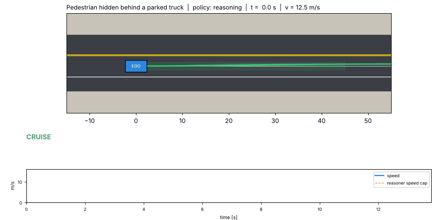
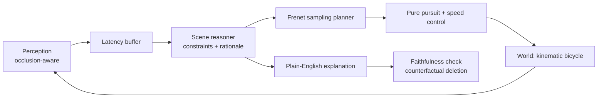

---
hide:
  - navigation
  - toc
---

Independent project · Autonomous driving · Nov 2026

# ExplainDrive: An Explainable Reasoning Planner

A small, fully inspectable driving stack that reasons about a scene, plans a path, says why in plain English, and checks that those explanations are true.

Pure Python (NumPy, Matplotlib). No GPU, no CARLA, no datasets. Every result regenerates with one command.

Motion planningFrenet plannerExplainable AIClosed-loop simPython

[Scenarios & results](results.md){ .md-button .md-button--primary } [Design notes](design.md){ .md-button } [:fontawesome-brands-github: View source files](https://github.com/LakshanandSugumar/explainable-av-planner){ .md-button }

The car slows for a crosswalk it cannot see, before anyone appears.

  
6Hard closed-loop scenarios

  
63%Fewer reasoner calls with adaptive reasoning

  
500 msLatency the stack tolerates collision-free

  
100%Explanation necessity & completeness

> *"My view of the crosswalk 11 m ahead is blocked by T1; limiting speed to 5.3 m/s so I can stop if someone steps out."* The car slows **before** it can see anyone. When the pedestrian appears from behind the truck, it stops comfortably. The reactive baseline in the same scene hits the pedestrian.

## The idea

Recent "reasoning" driving models plan a path *and* explain their decisions. ExplainDrive builds the same **reason → plan → explain** loop from first principles, small enough for one engineer to understand, test and measure end to end:

- a **scene reasoner** that turns what the car sees into driving constraints *and* the reasons for them,
- a **Frenet sampling trajectory planner** that drives inside those constraints,
- a **closed-loop simulator** with occlusion-aware perception, a kinematic bicycle model and 6 hard scenarios,
- and four experiments a reasoning model should face: baseline comparison, adaptive (fast/slow) reasoning, latency sensitivity for edge hardware, and explanation faithfulness checked with counterfactuals.

## Explore

-   :material-car-emergency: **[Scenarios & results](results.md)**

    Six scenarios with animations, and the four experiments with full tables.

-   :material-cog-outline: **[Design notes](design.md)**

    Loop timing, the constraint-based reasoner, the planner, the explanations and how faithfulness is tested.

## Want to go deeper?

Read the full write-up, browse the source, or see the rest of my work.

[:fontawesome-brands-github: View source files](https://github.com/LakshanandSugumar/explainable-av-planner){ .md-button .md-button--primary } [All projects](https://lakshanandsugumar.github.io/projects/){ .md-button } [Portfolio](https://www.lakshanand.dev){ .md-button }

