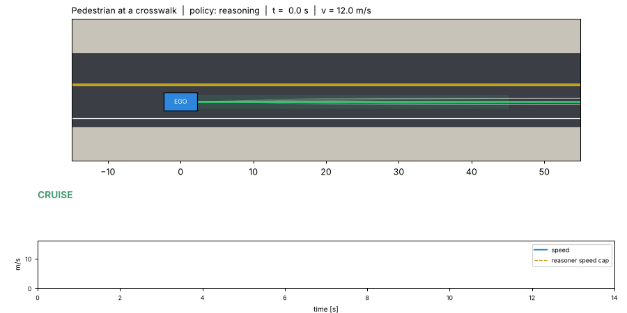
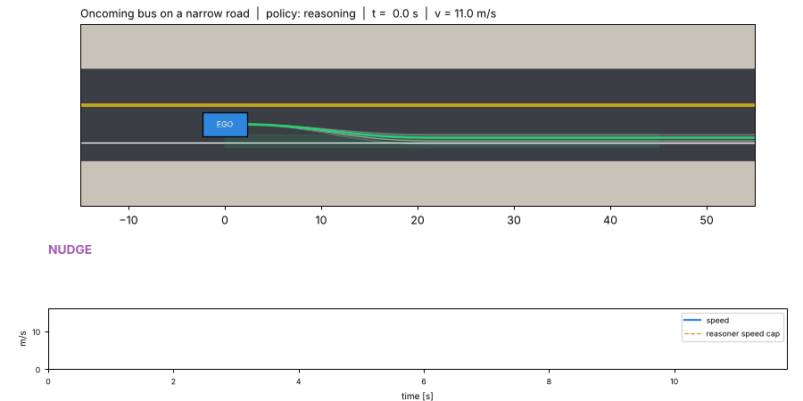
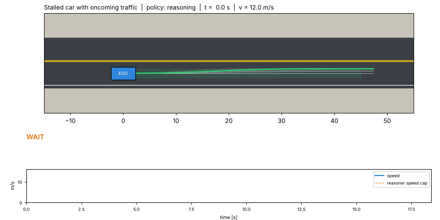
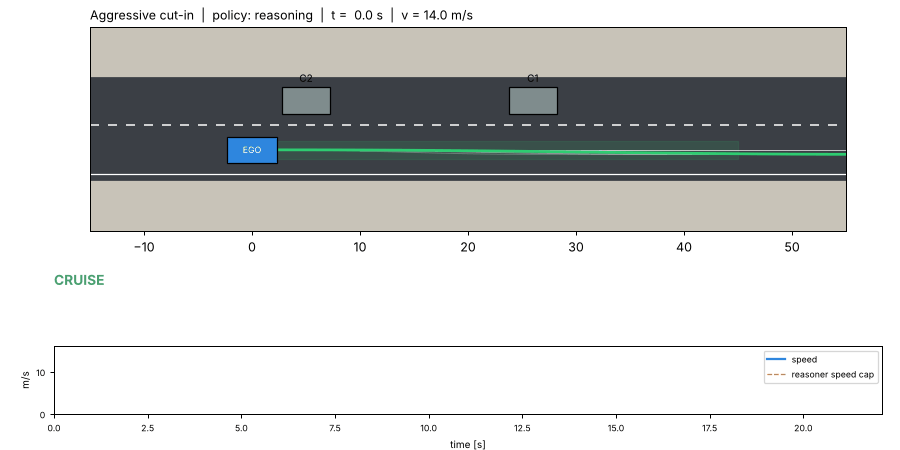
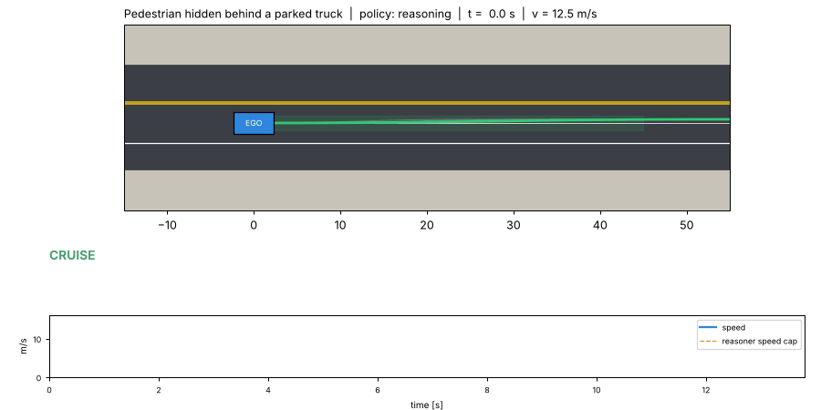
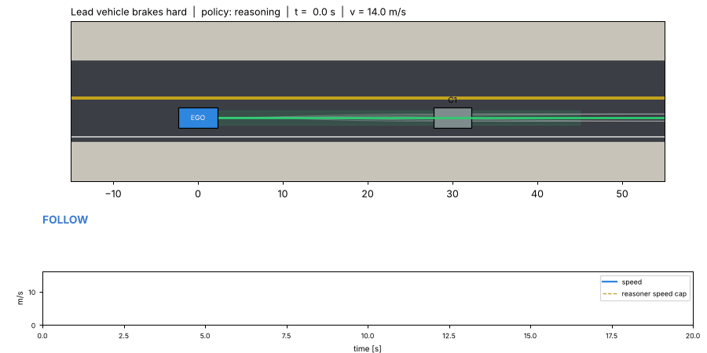
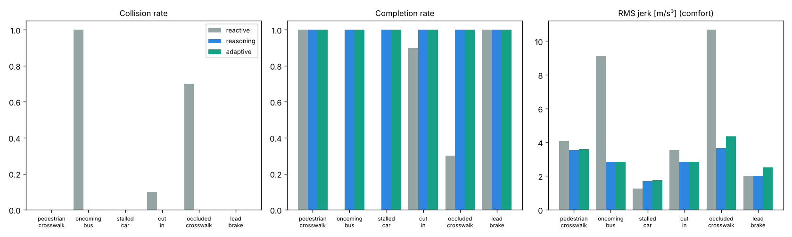
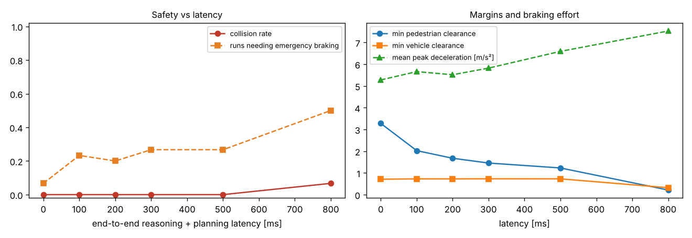
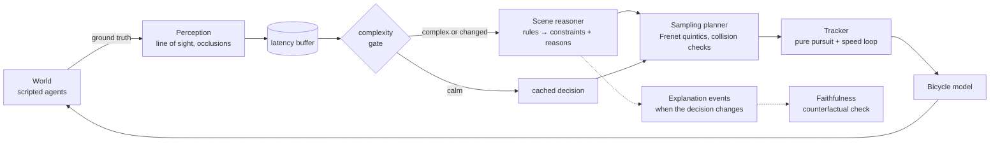

# Scenarios & Results

## Scenarios

| | scenario | what makes it hard | reasoning planner |
|---|---|---|---|
|  | **pedestrian_crosswalk** | a pedestrian steps off the curb | yields at the stop line until they clear its lane |
|  | **oncoming_bus** | a 2.55 m wide bus drifts 0.8 m over the centre line of a narrow road | shifts 0.9 m onto the shoulder and slows to 7 m/s |
|  | **stalled_car** | a broken-down car blocks the lane while oncoming traffic arrives | waits, edges left to see, then overtakes in the gap |
|  | **cut_in** | a slower car cuts in 12 m ahead | spots the lateral motion early and rebuilds the gap |
|  | **occluded_crosswalk** | a parked truck hides a running pedestrian | slows because of the *occlusion*, before it sees anyone |
|  | **lead_brake** | the lead car brakes hard to a stop, then pulls away | follows with a safe gap (a sanity check) |

Each scenario also takes a random seed (`make(name, seed)`) that varies timings, speeds and positions, which is what the experiments use.

The animations show the green **corridor** the reasoner allows, a red **stop line** when one is active, the chosen **plan** (green) and other candidate plans (faint), agents the ego **cannot see** (dashed), and the object **blocking the view** (purple outline). Below the road are the current explanation and the speed against the reasoner's speed cap.

Baseline runs for comparison: [bus](img/oncoming_bus_reactive.gif), [occluded crosswalk](img/occluded_crosswalk_reactive.gif), [stalled car](img/stalled_car_reactive.gif).

## Results

All numbers come from `python scripts/make_media.py` (seeded, deterministic). Raw JSON is in `results/`.

### 1. Does reasoning help? (reactive vs reasoning vs adaptive, 10 randomised seeds per scenario)

The **reactive** baseline is a typical ACC-plus-lane-keeping stack. It uses the same planner and the same collision checking, but it has no crosswalk, occlusion, nudging, overtaking or cut-in logic, and it assumes other cars stay in their lane.

| scenario | policy | collisions | completed | runs with emergency braking | min clearance [m] | RMS jerk [m/s³] | reasoner calls/s |
|---|---|---:|---:|---:|---:|---:|---:|
| pedestrian_crosswalk | reactive | 0% | 100% | 20% | 0.86 | 4.07 | 10.1 |
| pedestrian_crosswalk | **reasoning** | 0% | 100% | 0% | 3.62 | 3.55 | 10.1 |
| pedestrian_crosswalk | adaptive | 0% | 100% | 0% | 3.63 | 3.60 | 7.6 |
| oncoming_bus | reactive | 100% | 0% | 100% | 0.01 | 9.13 | 10.1 |
| oncoming_bus | **reasoning** | 0% | 100% | 0% | 0.71 | 2.86 | 10.1 |
| oncoming_bus | adaptive | 0% | 100% | 0% | 0.71 | 2.85 | 1.1 |
| stalled_car | reactive | 0% | 0% | 100% | 1.60 | 1.26 | 10.0 |
| stalled_car | **reasoning** | 0% | 100% | 0% | 0.92 | 1.71 | 10.1 |
| stalled_car | adaptive | 0% | 100% | 0% | 0.92 | 1.75 | 5.5 |
| cut_in | reactive | 10% | 90% | 30% | 0.21 | 3.55 | 10.1 |
| cut_in | **reasoning** | 0% | 100% | 20% | 1.60 | 2.85 | 10.0 |
| cut_in | adaptive | 0% | 100% | 10% | 1.56 | 2.83 | 1.1 |
| occluded_crosswalk | reactive | 70% | 30% | 100% | 0.00 | 10.67 | 10.2 |
| occluded_crosswalk | **reasoning** | 0% | 100% | 0% | 0.91 | 3.67 | 10.1 |
| occluded_crosswalk | adaptive | 0% | 100% | 0% | 0.84 | 4.35 | 5.7 |
| lead_brake | reactive | 0% | 100% | 0% | 12.43 | 2.00 | 10.1 |
| lead_brake | **reasoning** | 0% | 100% | 0% | 12.43 | 2.00 | 10.1 |
| lead_brake | adaptive | 0% | 100% | 0% | 10.11 | 2.52 | 1.6 |

Across all 6 scenarios × 10 seeds, the reasoning planner had a **0% collision rate** and completed **100%** of runs. The reactive baseline collided in **30%** and completed **53%**.

The baseline's failures are exactly where scene reasoning is needed:

* **oncoming_bus**: it collides in 10 of 10 runs. It stays in its lane and brakes, but braking alone cannot get it out of the way of a bus that is over the line.
* **occluded_crosswalk**: it collides in 7 of 10 runs. It reaches the hidden crosswalk at full speed and sees the pedestrian too late to stop.
* **stalled_car**: it never collides, but it never finishes either. It waits behind the broken-down car forever.
* **cut_in**: it collides in 1 of 10 runs. Because it assumes cars stay in their lanes, it notices the cut-in late.

On the two sanity scenarios (pedestrian_crosswalk and lead_brake), both stacks are safe. That is expected, since the shared planner's collision checking covers simple cases. Even so, the baseline needed emergency braking for the pedestrian in 2 of 10 runs, while the reasoning planner yielded early and never did.

The reasoning planner is not perfect: it needed emergency braking in 2 of 10 cut-in runs. In those seeds the car cuts in closer than the comfortable braking limits can handle, but it still never collided.

### 2. Adaptive "fast/slow" reasoning

Reasoning models are expensive, and on an edge computer you would not want to run one every 100 ms in an empty street. The **adaptive** policy runs a cheap scene-complexity score every tick. It calls the full reasoner only when the scene is complex, when the scene has just changed, or once per second as a heartbeat. The planner and its collision checks still run every tick.

| | full reasoning every tick | adaptive |
|---|---:|---:|
| reasoner calls per simulated second (mean over scenarios) | 10.1 | **3.8** |
| collision rate | 0% | **0%** |
| runs needing emergency braking | 3.3% | 1.7% |
| mean RMS jerk [m/s³] | 2.77 | 2.98 |

The adaptive policy cuts reasoner calls by **63%** with no collisions and no extra emergency braking. Its cost is a slightly less smooth ride (+8% RMS jerk), because it reacts to a slowing lead car up to one heartbeat late. On the oncoming bus it calls the reasoner 14 times instead of 119. On an edge computer, that compute budget could go to a much larger model that runs only when the scene needs it.

### 3. How much latency can the stack take?

The whole perception → reasoning → planning chain is delayed, so the car acts on a world that is up to 800 ms old, as it would with a large model on a slow embedded GPU.

| latency | collision rate | runs with emergency braking | min pedestrian clearance [m] | min vehicle clearance [m] | mean peak decel [m/s²] | collisions by scenario |
|---:|---:|---:|---:|---:|---:|---|
| 0 ms | 0% | 7% | 3.28 | 0.71 | 5.28 | none |
| 100 ms | 0% | 23% | 2.03 | 0.73 | 5.66 | none |
| 200 ms | 0% | 20% | 1.68 | 0.73 | 5.52 | none |
| 300 ms | 0% | 27% | 1.46 | 0.73 | 5.82 | none |
| 500 ms | 0% | 27% | 1.23 | 0.73 | 6.59 | none |
| 800 ms | 7% | 50% | 0.21 | 0.32 | 7.53 | cut_in: 1, occluded_crosswalk: 1 |

The stack stays collision-free up to **500 ms** of end-to-end latency. Latency still costs something: the minimum pedestrian clearance shrinks from 3.3 m to 1.2 m, peak braking rises, and emergency braking becomes more common. At **800 ms** the first collisions appear, in the cut-in and the occluded-pedestrian scenarios, which are the two where a hazard appears suddenly. Together these give a concrete latency budget for an on-vehicle reasoning model: under about 300 ms keeps the margins comfortable, and more than about 500 ms is unsafe for this scenario set.

### 4. Are the explanations true?

An explanation that names the wrong cause is worse than none. For every explanation, `faithfulness.py` re-runs the reasoner on the same scene with one agent deleted:

* **necessity**: deleting an agent the explanation *cites* must change the decision;
* **completeness**: deleting an agent it does *not* cite must not change the decision.

Over every explanation in 5 seeds × 6 scenarios, the test ran **71 cited-agent** and **79 uncited-agent** counterfactuals. **Necessity was 100%** and **completeness was 100%**: every agent the car blamed actually mattered, and nothing it left out did. Emergency stops come from the planner rather than the reasoner, so they are explained by the planner's rejection reasons and are not part of this test.

This check found a real bug during development. In the stalled-car scene, the "waiting" explanation blamed the oncoming car. But the ego could not see far enough down the oncoming lane anyway, so deleting that car changed nothing. The decision was overdetermined and the explanation picked the wrong cause. The fix was to cite only the binding reason and mention the other one in the text without citing it. See [docs/design.md](design.md#4-explanations-and-faithfulness).

### Explanation log

What the car "said" in each nominal scenario (all of it, because explanations are only emitted when the decision changes). Full log: results/explanation_log.md.

#### Pedestrian at a crosswalk

- `t= 0.2s` **cruise**: Cruising at up to 13.9 m/s; nothing in the scene needs a reaction.
- `t= 0.9s` **caution**: P1 is waiting at the curb by the crosswalk; slowing to 13 m/s in case they step out.
- `t= 2.3s` **yield**: Pedestrian P1 is crossing at the crosswalk 25 m ahead; stopping at the line until they clear my lane.
- `t= 7.2s` **cruise**: Cruising at up to 13.9 m/s; nothing in the scene needs a reaction.

#### Oncoming bus on a narrow road

- `t= 0.2s` **nudge**: Oncoming bus B1 is 0.8 m over the centre line; shifting 0.9 m right and slowing to 7 m/s to keep 0.6 m clearance.
- `t= 6.7s` **cruise**: Cruising at up to 12.5 m/s; nothing in the scene needs a reaction.

#### Stalled car with oncoming traffic

- `t= 0.2s` **wait**: Car S1 blocks my lane 53 m ahead; I cannot see far enough down the oncoming lane to pass safely yet, so I am slowing behind it.
- `t= 8.2s` **wait**: Car S1 blocks my lane 4 m ahead and oncoming car C1 is passing it right now (I need 8.8 s clear); waiting behind S1.
- `t= 9.8s` **overtake**: Car S1 blocks my lane; the oncoming lane is clear long enough (need 8.9 s), so I am passing it on the left.
- `t=14.3s` **cruise**: Cruising at up to 13.9 m/s; nothing in the scene needs a reaction.

---

## How it works

**The reasoner outputs constraints, not trajectories.** Each rule writes a speed cap, a stop line, a lateral corridor, a preferred offset or a lead vehicle, and attaches a `Rationale` that names the agents it depends on. The tightest constraint wins, and the highest-priority maneuver is the one reported. Because of this split, every explanation is grounded in a specific, checkable constraint, and the planner can be swapped or tested independently.

**The planner** samples quintic lateral paths in *distance travelled* (so they are drivable even when pulling out from a standstill) and quartic or quintic speed profiles. It rejects anything that breaks acceleration, curvature, corridor, speed-cap or stop-line limits, or that comes within a margin of any predicted agent. It then picks the cheapest of the rest by jerk, lateral acceleration, speed error, offset and proximity. If nothing is feasible it brakes as hard as it can and explains which constraint made every option fail.

**The LLM/VLM slot.** `llm_reasoner.py` writes the scene out as text, asks any `prompt → str` backend for a JSON decision, and merges it with the rules so that **the more cautious value always wins**. A model can add caution or choose a position inside the safe corridor, but it can never widen the safety envelope. Unparseable output falls back to the rules alone.

The full details are in **[docs/design.md](design.md)**: equations, every rule, the planner checks, and the bugs simulation exposed along the way.
