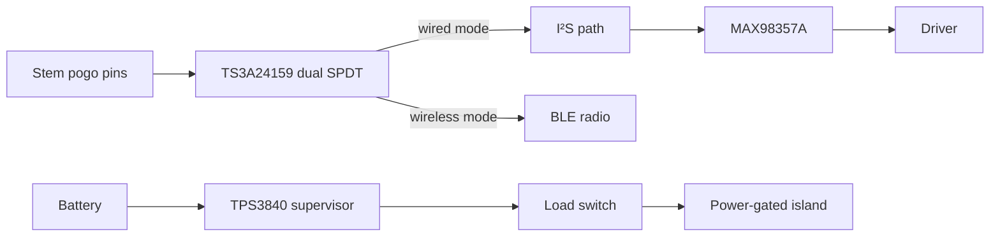

---
hide:
  - navigation
  - toc
---

Independent research · Hardware design · 2026

# Dual-Domain Galvanic Handoff Earbuds

A simulation-only IEEE-style paper on a true-wireless earbud platform that combines a hardware power-gated standby island with a physical lossless audio path through the stem, with the hardware designed in a narrow HDI rigid-flex stem.

Simulation-only study · hardware designed in KiCad / Cadence

TWS earbudsHDI rigid-flexPower gatingI²S audioKiCadCadence Allegro

[Architecture](#architecture){ .md-button .md-button--primary } [Design constraints](#design-constraints){ .md-button } [:material-email-outline: Source available on request](mailto:lakshanandsugumar@gmail.com?subject=Source%20files%20request%3A%20Galvanic%20Handoff%20Earbuds){ .md-button }

  
< 500 nAStandby current target

  
4.2 × 32 mmStem form factor

  
8-layerHDI Type-III stackup

  
0.4 mmWLCSP pitch

## The idea

Mass-market true-wireless earbuds trade standby life and audio fidelity against size. This platform proposes two subsystems that live together in a narrow earbud stem:

## Architecture

| Subsystem | What it does | Key parts |
| --- | --- | --- |
| **Hardware-enforced power-gated island** | Cuts standby current below 500 nA using a voltage supervisor and a load switch, with no microcontroller polling needed to decide when to wake | TPS3840 supervisor, ultra-low-Ron load switch |
| **Physical lossless audio bypass** | Routes the stem's pogo pins through an analog switch into a digital I²S audio path, so a wired audio source bypasses the wireless link | TS3A24159 dual SPDT switch, MAX98357A I²S DAC |

## Design constraints

| Constraint | Value |
| --- | --- |
| Form factor | Narrow stem, 4.2 mm × 32 mm maximum |
| Stackup | 8-layer HDI Type-III (1+N+1 stacked micro-vias, via-in-pad) |
| Trace / space | 3 mil / 3 mil |
| Silicon footprints | 0.4 mm pitch WLCSP |
| RF | 50 Ω single-ended BLE antenna |
| High-speed pairs | 90 Ω differential, protected by a TPD4E012 ESD array |

## Status

The paper is a simulation-only study. Results and the full write-up will be added here when it is published.

!!! note "Source files"
    The code and design files for this project are shared on request. [Email me](mailto:lakshanandsugumar@gmail.com?subject=Source%20files%20request%3A%20Galvanic%20Handoff%20Earbuds) and I'll send them over.

## Want to go deeper?

Read the full write-up, browse the source, or see the rest of my work.

[:material-email-outline: Source available on request](mailto:lakshanandsugumar@gmail.com?subject=Source%20files%20request%3A%20Galvanic%20Handoff%20Earbuds){ .md-button .md-button--primary } [All projects](https://lakshanandsugumar.github.io/projects/){ .md-button } [Portfolio](https://www.lakshanand.dev){ .md-button }

