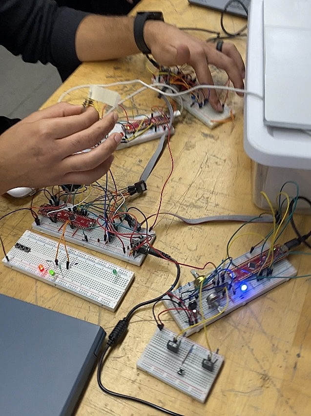
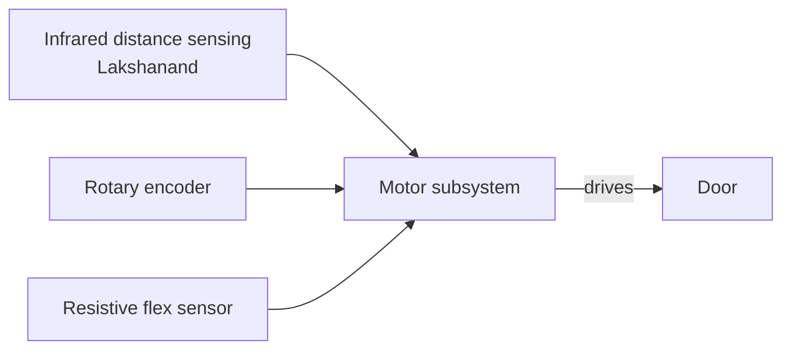

EGR 304 · Fall 2025 · Team 103 · ASU Polytechnic

# IR Motion-Sensing Door Actuator

A self-calibrating automatic door for private homes that opens when someone approaches and stops if anything is in its path. I designed the infrared distance-sensing subsystem from concept to working prototype.

Team 103: Isaac Smith, Christo Joseph, Seth Merwin, Lakshanand Sugumar · Instructor: Dr. Daniel M. Aukes

PIC18F57Q43IR sensingSignal conditioningPCB bring-upEmbedded C

[My subsystem](subsystem.md){ .md-button .md-button--primary } [Team site](https://egr304-2025-f-103.github.io/){ .md-button } [:fontawesome-brands-github: View source files](https://github.com/EGR304-2025-F-103/egr304-2025-f-103.github.io){ .md-button }

All four subsystems connected at the end of the course.

  
100%Design review score: functionality & documentation

  
4Embedded subsystems in the product

  
< $300Target consumer cost

  
1Button press to self-calibrate

## The product

Automatic doors are common in stores and offices, but rare in homes. Team 103 set out to bring a light-duty, inexpensive and easy-to-install automatic opener to any interior swinging door, aimed first at people with disabilities and their caregivers, and at anyone with their hands full.

After a simple install, one button press opens and closes the door while the sensors learn its normal path. From then on, the door opens when someone approaches from either side, waits, and closes, and it stops if an obstacle or an unusual change in its path appears. Four embedded subsystems, each designed by one team member, make that work:

The subsystems connect through 8-wire ribbon cables; the motor board acts as the hub and bridges the flex sensor and encoder during calibration.

## Demo video

The final integrated system: all four subsystems on breadboards, sharing one power source and communicating with each other as designed. (Per the team's notes, class-wide setbacks kept the team from soldering the final PCBs or building a housing and model door before the deadline.)

<iframe src="https://www.youtube-nocookie.com/embed/ntUvapRTiwo" title="EGR 304 Team 103 door automation demo" style="position:absolute;top:0;left:0;width:100%;height:100%;border:0" allow="accelerometer; encrypted-media; gyroscope; picture-in-picture" allowfullscreen></iframe>

## Explore

-   :material-motion-sensor: **[My subsystem](subsystem.md)**

    The infrared sensing front end, conditioning circuit, PCB and firmware.

-   :material-account-group-outline: **[User needs](team/user-needs.md)**

    Who the door is for and how existing products compare.

-   :material-clipboard-list-outline: **[Requirements](team/requirements.md)**

    Objective, stakeholders, user stories and requirements.

-   :material-sitemap: **[Block diagram](team/block-diagram.md)**

    How the four subsystems connect.

The team-project pages on this site are the Team 103 documentation, reproduced with credit to the whole team. The original is at [https://egr304-2025-f-103.github.io/](https://egr304-2025-f-103.github.io/).

## Want to go deeper?

Read the full write-up, browse the source, or see the rest of my work.

[:fontawesome-brands-github: View source files](https://github.com/EGR304-2025-F-103/egr304-2025-f-103.github.io){ .md-button .md-button--primary } [All projects](https://lakshanandsugumar.github.io/projects/){ .md-button } [Portfolio](https://www.lakshanand.dev){ .md-button }

