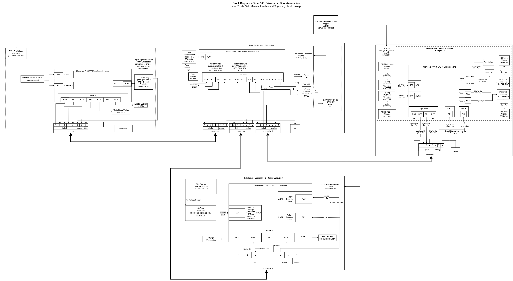
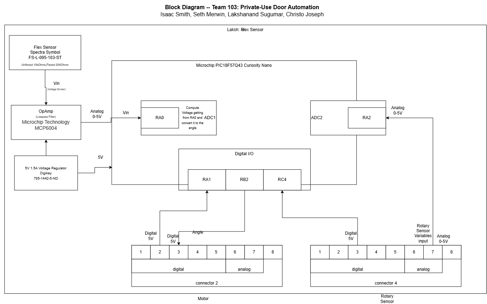

## Description

The block diagram below shows how our team's individual subsystems connect to each other. Each major block represents one subsystem showing the programmed microcontroller, which pins of it are being used (and how), and what those pins are connected to. The subsystems will connect to each other via a total of four 8-wire ribbon cables. The pin-headers for these cables are shown at the bottom of each subsystem block, and they display which of their pins are connected to the subsystem. Any pins on the headers that do not have arrows will not be used in the design. The large, bold, bidirectional arrows between subsystems represent the 8-wire ribbon cables themselves, showing which subsytems are directly connected to each other. This diagram helps the team and stakeholders understand the general function of each subsystem as well as how they will be communicating to form a complete system.

## Block Diagram of Subsystems

This is the whole system where each subsystem is connected to another with an 8-wire ribbon cable. The motor is used as a bridge from the flex sensor and the rotary encoder during initial calibration. Every subsystem is then connected to the motor to feed and recieve information from its inputs and motion.

### Motor

 

Link to Draw.io is [here](https://viewer.diagrams.net/?tags=%7B%7D&lightbox=1&highlight=0000ff&edit=_blank&layers=1&nav=1&title=Individual%20Motor%20Subsystem.drawio&dark=auto#R%3Cmxfile%3E%3Cdiagram%20name%3D%22Page-1%22%20id%3D%22eZ7gXXGAp_J01Qm2sftV%22%3E7V1dd6q4Gv41rjX7wq6Eby5b3e3sc9p9OnZmz%2Bxzl2qqTNE4iK3uXz%2BJgkKSgggkuNa%2BaSEmQJ68X08SXnrmYL65i9By9kAmOOwZYLLpmcOeYUAIPfqPlWz3JQ5ICqZRMEkqHQuegh84KQRJ6TqY4FWuYkxIGAfLfOGYLBZ4HOfKUBSR93y1FxLm77pEUywUPI1RKJb%2BGUzi2b7Us8Gx%2FFccTGfpnSFIfpmjtHJSsJqhCXnPFJmfe%2BYgIiTeH803Axwy8FJc9u1uP%2Fj18GARXsSnNHjZ%2FP8p%2BjGO%2FYdv%2FzjDu6%2Ff%2FbtJ39hf5Q2F66TDX1YIjXvmNS19IDGJkoePtykiEVkvJphdFPTMm%2FdZEOOnJRqzX9%2BpDNCyWTwP6Rmkhy9BGA5ISC9jDhdkQSvdvOEoDijA12EwXdDimLA2Ym%2BSDrLqeJMpSnp3h8kcx9GWVkl%2BtbwE6UTUoJ%2Bcvx8HzneSsllm0CwrKUSJsEwP1z7iSQ8SSCvA60EB38bxnKDVbNccNgMjNKw8jgYQcYSeDEejNRxFOe08jjYsh9E1JTAaflswmgKKD8E4IuNZsKTFj18G0Lu13d8sWg8M1lFAVkHMevQVLUg9vOVKLxmFOXlDz7tbsGYRXgU%2FsuckRnHmnHobnD3HkyB7GpLx6%2BEJEw%2BR%2BbmJQbbt%2FCAb4iDbQDbIsK1BtoSRwhPq0pJTEsUzMiULFH4%2Blt7kx%2FJY556wcdqB9TeO423in9E6JvnxpQhG279Y%2Bys7Pf2eXG53Mtzkzrbp2SaIM83o2ff0ivT42IidpG0%2BHLYVWUdjXACN7SQRBIqmOC5SlERTGHKFYhDhEMXBWz5YkA1p0vSRBPShD%2BLjGnnxsU1OKvZPmrQ6CsZ1FKFtptqSVVgV3Adw97G4WKHsufL16cH%2BCY5SesDkfMG1tQiuVABBoQCeK%2BznC65xquCmcWnbguvYJYK771JtwRXuYxcLru8X1m9HcJ0LFFxoZCUXXgFYZqnZ2SOOAooWjupLNDxVog01Es178rYkmr%2BPVSLRjmHWq2%2FC9jXA1asBLoAZHWDCbJ2oBznzfeXaZUpAr9KcDqSiXaoDfisqUFVyfWDkJcsrlkQIfFCvgQ3t9mXX0yy7vpGXXeCcJbvGT9ktkl2Ls7puiShCjr1Xb%2BApkN0E3Ny0iBPGjBkHb%2FRwGu8GeV%2B0WqJFWvZr%2FyYK2JAkv9G7Z3%2FOFEsu9OG1M0rk%2FLNmE5s3z2j8Ot2pS3%2B8Z%2FpsZjGaPv9iMEdIuw0OBxAYn%2FbXTBqnd0ET9BKtg1jT04aMtvcnKHr9peDBd0fsd9PdH6f%2Fwad9r8DHlwRJzbTB8WLizejBJzlM9%2F5OCMHwyyP96102WnzneoZpWZ5fsVN15qxC9IzDm0MfuYmqD01nhZlWaMmNTG6mFUpmj5y2Jo%2FSmxVblGRhoFM2YkSeSbyaUf97ESbN9izw512fsoHHh77N4h4AjW8KpbsJ%2BTUBF69ZEvmVzX62J79QQEVhNJdlIUdeXi2OKwvjzg%2FZ%2FBMjNtjOHFLVkA0aLiddoCQEExq4CiZ%2FEopSYjHvIoyZNbn%2FPGxDmSdBhMdxQNjSCkaruCH9hk4%2BajY9Ub9lC6r81Elz6u1IwOaAY6Z5%2BWHv86tAvcN6TYUlH35uXOa0Zai0Z%2FRcAZWkm8xLA9Ek1lq6o242JnOphBWPWTnC%2BhD0BAQnwTSIUXgx2B1WmU%2FzwK0t1UORkyLqS8n0YpDccLB9jKylElhDDM1ranarCmwoxUbcZyM6Bs3YbD4UI7VQGQJUZkehkrAJtVCJ%2B2XEzRXdgMrRDZUlQCUu53cDKkkMqxYqkTCIC8jdgApKtqypxUqM98Wlxo5gpd2wiyxAXNrqCFbaLbsY7wtQtc0jHX6rinYeaYihe5ZH1oyo6kbwhzHrMI80xRi9EzyyAnZd4ZGmGNJ3gUdWQLKjPNIUCYAaHnmeAiv1C6YY8avhkdXFSne4YYoRvxoeWR0q3dGGKUb8anhkdah080hTDPjV8MjqUOnmkaYY76vhkTVcoDasxHhfDY88Ayvthl1kAWp45BlY6bbslhjvC1C1zSM9p2s80hJD9yyPrBkm1I3grdMR1oegGKN3gkdWwK4rPNISQ%2Fou8MgKSHaUR1oiAVDDI89TYLV%2BQYz41fDI6mKlO9ywxIhfDY%2BsDpX2aEOM%2BNXwyOpQ6eaRlhjwq%2BGR1aHSzSMtMd5XwyNruEBdWKWvVyvnkWdgpduw2yILUMMjz8BKt2VP36bLYDVM433whV7yf%2FWQU5mGyeY3DUv4qCVLH9Qam7LFgOJnSpQ0d0EyWKVvBaSyr%2FmtANvjXuQsyWRim4X123knwBap0ei28fijsmY6XBYYS%2BJOZRSyte389knvToxunY6%2BAOXwbxVrB1QkU6PbxiOU6jjxSqsdJ5FJjW70Kyifdkk%2FTiKNGg07gJPTNZx8LRHGIVKw7FwSoCvfMwvjhTqxSYM5JLwTY490qlFz7OF6hal1SuvbfIZWrr7n2kX124lVHJHSjoaNTwBUVnGva7GKI9LZ0VC%2Fa%2FU0hiDX930Ibn9bw8Hfv%2BO%2FPkcAEqwpi19qz2CvelKc88gWZ4vOZF%2FmiRbQr2nv6om%2BuIQmCdMhAK8MBhJTGAKydxHdSrqgOY9Mxad9hA7479fLzuLSes6bnmFCj%2FnhQpQqdj6O0GKV6rOaXjhozpzD4nm1zI%2FuJeQBMbjAxbTNq7Qom3xd4oc848puy2yJszCy2QUKVGt5GZoAl0%2FCYJmih1eahMERZ21Gt40vRNaed9YfMUomYwYdiKy7Nhnj6Mkeemb%2BHbXT8%2BnaSWmA6HSDIvu8cDnFlBdCfsqrcgNLQZ5FRzIPNtBv8vyuzRc6eubBaquyb7tZZb4ChlGo0Jpyqaa5pnRn5gLpvqMTc1JDCO16DUxfgZa7sqmwxvc0VtfyrgU2rp4ke5k5a8PMa7rvlql6s9nr05ffyrPXu4o1NjewTeiEoWOszx8Zqx0TKc7V867X5C7R0JdbPD5LQEkSRP65qtZX87mATm3IKfvyRQ1hPPWzLenigu7onXfTfonw8J4pX78l4bmoD1ydLzzGqVGhpdrHfLDTil%2B9NIuFxzcL67ckPJK5qyHQHuJB0LXlTvdiPmpUQ8NOXX2zu8G7bD4WgMUa5vBvhkIVGiZurcrNuksWYV7IIu6vdjLBVligs9xIl0h2F3k%2B%2FxK770HSX4cBmkZoTo%2F6ffrnd7w7hsDcN36MgjcU4%2F4fK8wqk91Lq9dUVudol2L5uE7wXGE17tyH3n%2BP1wBP84Aagt060hNmR%2BABR%2B%2FBYlckXz3q%2BqrXPXpdzdACLSasU%2Bvpeo6ifZvBLApW1DgY4D9khZezeuth1AjHeTuziiPyirkd8ZJN8ijZHD%2BmmDDaKOyanweTyc70yXxE3hyy0U4MH3SacRsW53Jl6bmVvrfsyvKqCUtu9jcm7Vc2E6w3EsbsE9wGGOHpmlrPzn1Ygr2I8Yq3l7FnwPXsPrQso2%2F3vw4vfFUZcN%2FzPnwyt%2By1fNjEezrSzU2d4q2nUY9G9im5%2FomR0n6rkK6NSuljlmxUYt9ZATvr88ci2lud3SaAR%2FLOtixRV7RchlvNmt269%2F35Ua2TYDJt48Ls5oEoqrCb9DQiDLAjh6Cdmj2QCWY1%2FgU%3D%3C%2Fdiagram%3E%3C%2Fmxfile%3E).

Link to subsystem website is [here](https://isrysm52.github.io/01-Block-Diagram/Block-Diagram/).

- Importance:

This subsystem is the main brain of the Automatic Door Opener. The motor takes information from the flex sensor, the rotary encoder, and the two distance sensors to determine if it should move forward or backward. It also uses the information given to stop and wait for more input if there are problems with movement.

- Correlation to Requirements

This subsystem uses the motor to open the door, stop the door, and is attached to the latch that will diengage the motor in case of emergencies. This is the focus on safety while the automatic door opener and closer is being used.

- User-Interface Connections

This subsystem has the potentiometer that will give the user the abitilty to manually slow down and speed up the door. This subsystem also has lights that will be labeled in the manual for when it is activated, moving, and stopped by something in the way.

### IR Sensors

Link to Draw.io is [here](https://github.com/EGR304-2025-F-103/egr304-2025-f-103.github.io/blob/main/docs/Documents/Distance_Sensing%20Subsystem%20Block%20Diagram.drawio).

Link to subsystem website is [here](https://samerwin1.github.io/01-Block-Diagram/Block-Diagram/).

- Importance:

This subsystem is responsible for auto-calibration of the system, sensing users approaching the door, and detecting obstacles in the path. When sensing someone approaching, the subsystem tells the motor to begin opening the door. While the door is opening or closing, the subsystem is checking to make sure nothing is in the way at several points along the path.

- Correlation to Requirements

This subsystem specifically contributes to **Software/Functionality**(Aspects 2.1 and 2.2), **Interactivity and User Experience**(Aspects 3.1 and 3.2), and **Safety**(Aspects 6.1 and 6.2) from the Product Requirements page.

- User-Interface Connections

This subsystem provides a virtual interface in the form of a non-physical switch which is automatically activated as a user approaches the door. It also has an LED which will inform the user of whether the system is in a normal operating state or there is an obstacle detected.

### Flex Sensor

Link to Draw.io is [here](https://app.diagrams.net/#G1aowyaz1jB5e_mhioJ-Hf5ubIlwDby4pD#%7B"pageId"%3A"smGOTXmF8ZFHZr45nH4Z"%7D).

Link to subsystem website is [here](https://lakshanandsugumar.github.io/lakshtest01.github.io/01-Block-Diagram/Block-Diagram/).

- Importance:

This subsystem is responsible for reading data from a flex sensor and communicating with the motor subsystem to control movement based on the sensor’s readings. At several points along the path of the door, the subsystem is checking that the amount of flex from the doorframe to the door matches up with the rotational angle of the door.

- Correlation to Requirements

This subsystem receives real-time data from the rotary encoder to determine whether the door is rotating as expected. It then compares this information with the flex-sensor readings to decide if the door should be stopped for safety reasons or due to a power loss or mechanical detachment between the motor and the door.

By continuously comparing the rotation pattern of the motor (rotary encoder) with the actual movement of the door (flex sensor), the system can detect abnormal conditions—such as an obstruction in the door’s path. In such cases, the slope or rate of change in the sensor signals will no longer match, allowing the subsystem to immediately trigger a stop signal and prevent damage or injury.

- User-Interface Connections

The motor is controlled through this subsystem, which continuously compares the slope of the rotary encoder signal with that of the flex sensor. If the two signals no longer align—indicating a possible obstruction, detachment, or unsafe condition—the subsystem instantly issues a stop command to the motor to ensure safety and prevent mechanical failure.

### Rotary Encoder

Link to Draw.io is [here](https://drive.google.com/file/d/13LKkwTJjgqqxmauylCVNC0H4SzO0dGRc/view?usp=sharing).

Link to subsystem website is [here](https://chvisto.github.io/01-Block-Diagram/Block-Diagram/).

- Importance

The rotary encoder provides feedback regarding the position and movement of the door with great detail. It will keep track of how far and in which direction the motor shaft has rotated and report that back to the microcontroller. This way the system may move the door with its required angle without a situation where the system over rotates or stops before it reaches the required angle.

- Correlation to Requirements

This subsystem provides support to the project's primary requirement of accurate and reliable motion control. The rotary encoder allows the motor to respond appropriately to positional feedback, preventing irregular operations. It also contributes to calibration and safety functions by confirming that the door returns to its resting position after each cycle. It would not be possible to achieve precision for smooth and dependable performance without it.

- User-Interface Connections
This subsystem includes a setup button that allows the user to initiate calibration at startup. When pressed, the system begins aligning the rotary encoder’s position with the door’s physical limits setting the reference points for fully open and fully closed positions.

During this process, the LED indicator provides visual feedback to confirm calibration status during setup and turning solid when calibration is complete. Beyond this stage, the subsystem runs automatically in the background and requires no more user interaction.

## Summary

Each component was chosen carefully to ensure safety as our top priority. Every system needed to connect to the motor to listen if the motor was in motion or tell the motor that there is something in the doorway so that the motor starts to open the door. This already met product requirements to open and close the door based off of sensors instead of a key fob, knob, or button. This also lets the door stop itself from closing into the user which enhances the safety and our requirement to make this door convienient and safe for all users.

The next part of safety is two fold. The door calibrates itself at the begining of the installation process. This calibration can happen again if the button is pressed and there is a problen during calibration. This ensures that if there is additional strain on the product or an unforseen incident, the product will stop and prevent further injuries to itself and potentially the user.

In conclusion, safety and convienience was always the number one requirement for our product. This should be used to help households and and destress inconvienient situations, not to cause more issues during an already stressful day.
