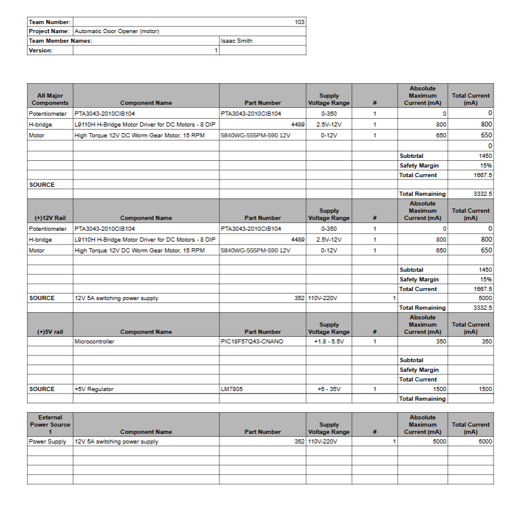
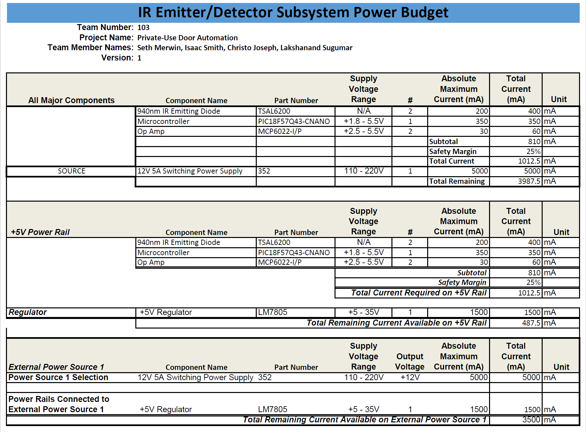
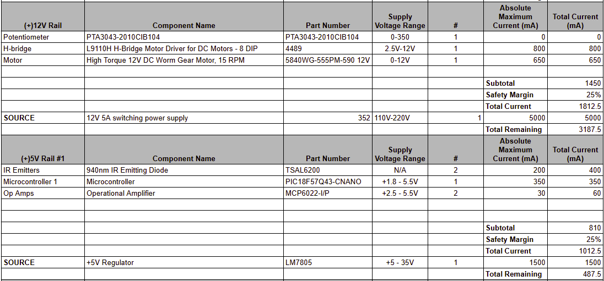
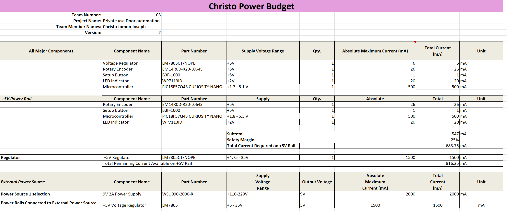

## Description

This page shows the power budget for the major components involved in the circuitry of all four subsystems. The power budget was created to theorize maximum possible current draw from each major electrical component, as well as describe how the power for each system will be supplied. This ensures that the power source/voltage regulators are capable of providing all necessary current to every system without being overloaded.

## Power Budget

## Individual Power Budgets

Motor Subsystem power budget:  

Distance-Sensing Subsystem power budget:

Flex Sensor Subsystem power budget:

Rotary Encoder Subsystem power budget:

## Conclusions

The Power Budget shows that, using the 12V wall power supply and 5V linear regulators, all of the team's components from each subsystem will be powered safely and with extra headroom for minor components. Each subsystem is powered together by one 12V power supply that is directly in the motor subsystem.

## Resources

The power budget as a PDF download is available [here](https://github.com/EGR304-2025-F-103/egr304-2025-f-103.github.io/blob/main/docs/Documents/Power%20Budget%20T103%20EGR%20304%20-%20Sheet1.pdf), and a Microsoft Excel Sheet [here](https://github.com/EGR304-2025-F-103/egr304-2025-f-103.github.io/blob/main/docs/Documents/Power%20Budget%20T103%20EGR%20304.xlsx).
