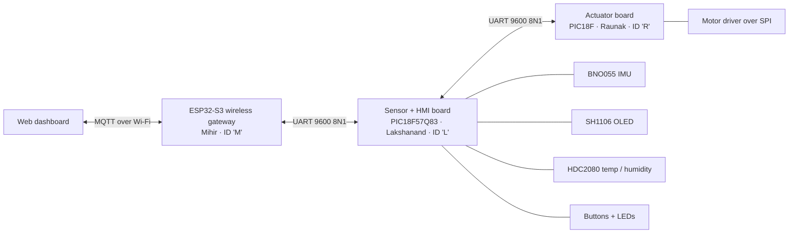

EGR 314 · Spring 2026 · Team 302 (XPED) · ASU Polytechnic

# R6 Recon Amphibot

A three-PCB modular amphibious scout that relays live sensor telemetry and takes motor commands over Wi-Fi. I owned the Sensor + HMI subsystem end to end.

My role: Sensor &amp; HMI subsystem lead · Team: Mihir Patel (ESP32 wireless gateway), Raunak Singh (actuator board), Lakshanand Sugumar (sensor + HMI)

PIC18F57Q83BNO055SH1106 OLEDHDC2080UART daisy chainMQTTCadence

[My subsystem](subsystem/requirements.md){ .md-button .md-button--primary } [Team report](https://egr314-s-2026-302.github.io/EGR314-Team302.github.io/){ .md-button }

  
3Custom PCBs in a UART daisy chain

  
9600 8N1UART link, AZ…YB framed packets

  
4OLED telemetry pages

  
0Board respins needed after the I²C fix

## The robot

The R6 Recon Amphibot is a modular exploration robot built to scout hazardous places (flooded buildings, chemical spills, collapsed structures) and send real-time sensor data and motor telemetry to a remote operator over Wi-Fi using MQTT. Three custom boards talk over a UART daisy chain:

At the EGR 314 Innovation Showcase the team demonstrated two-way MQTT with live telemetry on a web dashboard, packet routing across all three boards, real-time IMU tilt, temperature and humidity on the OLED and over MQTT, remote motor control, and a Wi-Fi-loss emergency-stop failsafe.

## What I built: the Sensor + HMI subsystem

- **Hardware.** Component selection, schematic capture, two-layer all-SMD PCB layout around a PIC18F57Q83 (QFN-48) with an AP63203WU-7 buck regulator, BOM, surface-mount assembly, bring-up and design verification.
- **Sensors and display.** BNO055 9-DOF IMU in NDOF fusion mode (Euler angles), HDC2080 temperature and humidity, and an SH1106 128×64 OLED framebuffer driver with four switchable pages and pushbutton paging.
- **The I²C rescue.** After fabrication, a peripheral clock misconfiguration (I2C1CLK on MFINTOSC instead of FOSC/4) blocked hardware I²C. I wrote a bit-banged I²C driver in C that kept the BNO055, SH1106 and HDC2080 working with no board respin.
- **Communication.** Built and debugged the three-node UART daisy chain at 9600 baud, 8N1, with AZ…YB framed ASCII command and telemetry packets, validated on an oscilloscope and logic analyzer. My board publishes sensor data to the gateway every 5 seconds, relays motor commands to the actuator board and acts on emergency-stop broadcasts immediately.
- **Documentation.** Driver API documentation and the final datasheet report; passed subsystem hardware verification and external design review.

## Explore

-   :material-clipboard-check-outline: **[Requirements](subsystem/requirements.md)**

    What the subsystem had to do, and what it achieved.

-   :material-sitemap: **[Block diagram](subsystem/block-diagram.md)**

    Pins, peripherals and interfaces on the sensor board.

-   :material-chip: **[Schematic & PCB](hardware/pcb.md)**

    Layer-by-layer PCB walkthrough and the schematic.

-   :material-flash-outline: **[Power budget](hardware/power-budget.md)**

    Rail currents and regulator selection.

-   :material-swap-horizontal: **[API & UART protocol](firmware/api.md)**

    Packet format, message types and board IDs.

-   :material-lightbulb-on-outline: **[Lessons learned](lessons/lessons-learned.md)**

    What bring-up taught me, written for the next team.

## Team documentation

The full team report (concept design, team-level requirements, process diagrams, the 64-byte message specification and the showcase video) lives on the [Team 302 site](https://egr314-s-2026-302.github.io/EGR314-Team302.github.io/). The pages on this site come from my individual subsystem datasheet.
