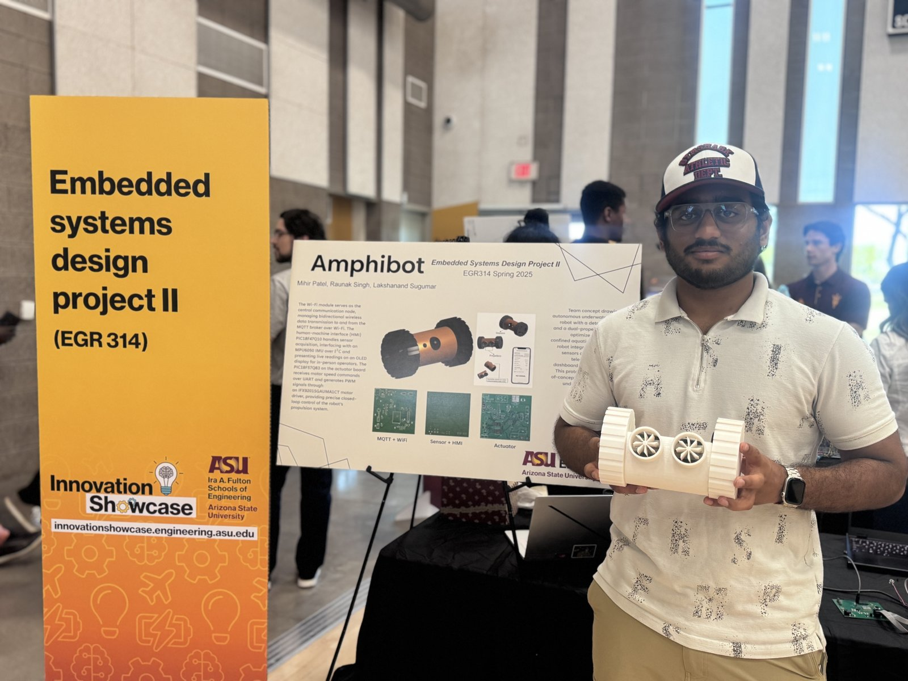
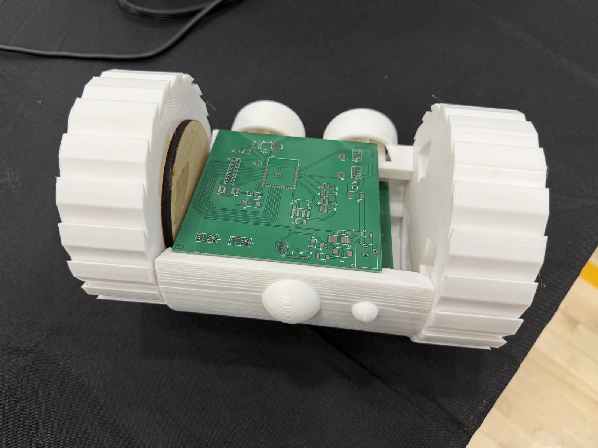
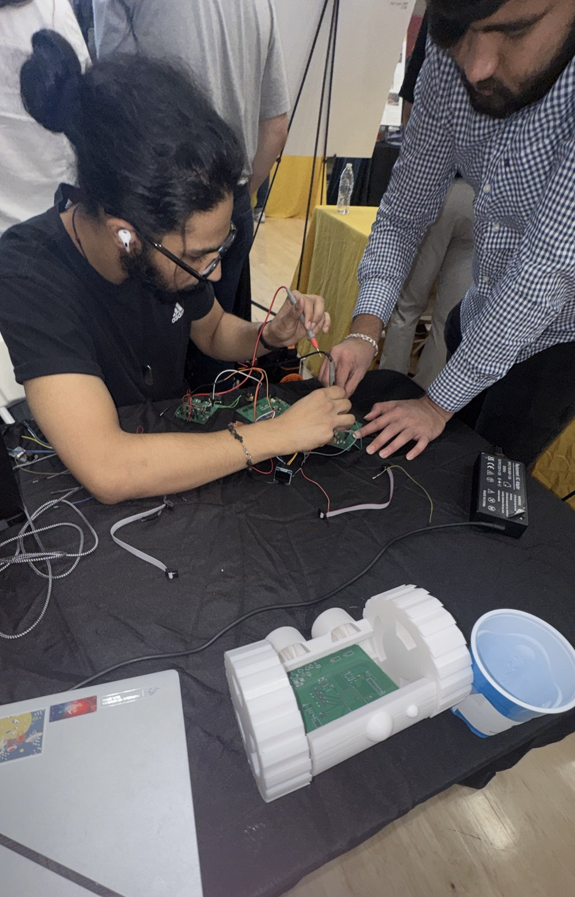
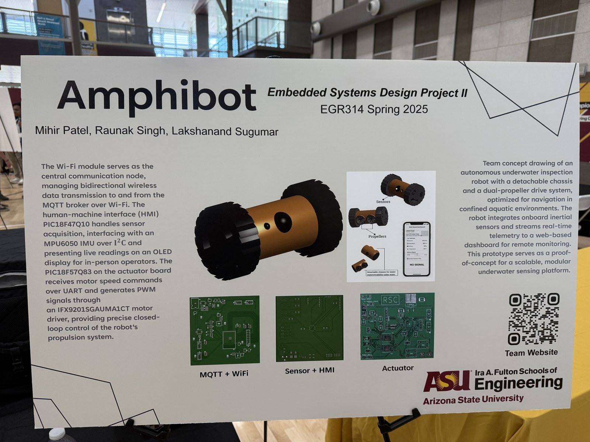

# Showcase & Demo

The R6 Recon Amphibot was shown at the EGR 314 Innovation Showcase at Arizona State University.

## Demo video

The walkthrough covers the system architecture, each subsystem, and how the UART daisy chain, MQTT and sensor telemetry work together.

<iframe src="https://www.youtube-nocookie.com/embed/wF2qDuwnyOg" title="EGR 314 Team 302 R6 Recon Amphibot demo" style="position:absolute;top:0;left:0;width:100%;height:100%;border:0" allow="accelerometer; encrypted-media; gyroscope; picture-in-picture" allowfullscreen></iframe>

## What was demonstrated

- Two-way MQTT between the ESP32 gateway and the web dashboard, with live telemetry on screen
- Packet routing across all three boards in the UART daisy chain
- Real-time IMU tilt, temperature and humidity on the OLED and published over MQTT
- Motor control from remote commands sent through the web interface
- The Wi-Fi-loss emergency-stop failsafe shutting the motors down when the broker connection dropped

## Photos

*At the Innovation Showcase with the 3D-printed Amphibot chassis and the team poster.*

*The half-open 3D-printed chassis shows how the three PCBs sit inside the body and connect to the drivetrain.*

*Team XPED working on the system during the showcase.*

## Poster

[Download the poster (PDF)](img/showcase/poster-egr314.pdf){ .md-button }
