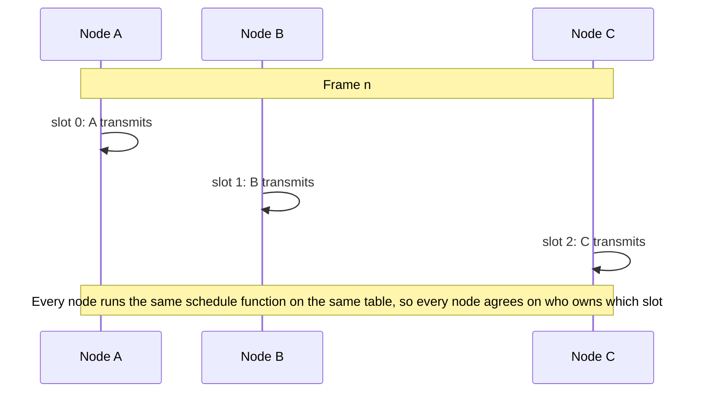

# How It Works

## Physical layer

SDCF runs on **RS-485**, a wired multi-drop bus that is cheap, robust and already common in industrial equipment. Each node is a PIC18F57Q83: a deterministic core with no cache, so exact timing bounds can be derived from the datasheet and the compiled instruction listing.

## Time-division schedule

Time on the bus is divided into frames, and each frame into slots. Every node owns one or more slots and transmits only in its own slots, so frames never collide.

## Protocol mechanisms

| Mechanism | What it does |
| --- | --- |
| Masterless slot self-allocation | Nodes claim slots without a coordinator and converge to a collision-free schedule |
| Anchor election | Nodes agree on a timing anchor so frames stay aligned |
| Join contention | New nodes contend for entry using binary exponential backoff |
| Admission control | Bandwidth is assigned with each node's control period in mind; a join that would break the period is refused |
| Buddy fault takeover | Each node has a peer that takes over its role if it stops transmitting, within a bounded number of frames |

## Timing method

Hard timing bounds come from **static worst-case execution time (WCET)** analysis by instruction-cycle counting on the PIC18F57Q83, not from a laptop simulation. The simulator measures protocol-level quantities only: convergence frames, collision counts and takeover latency.
