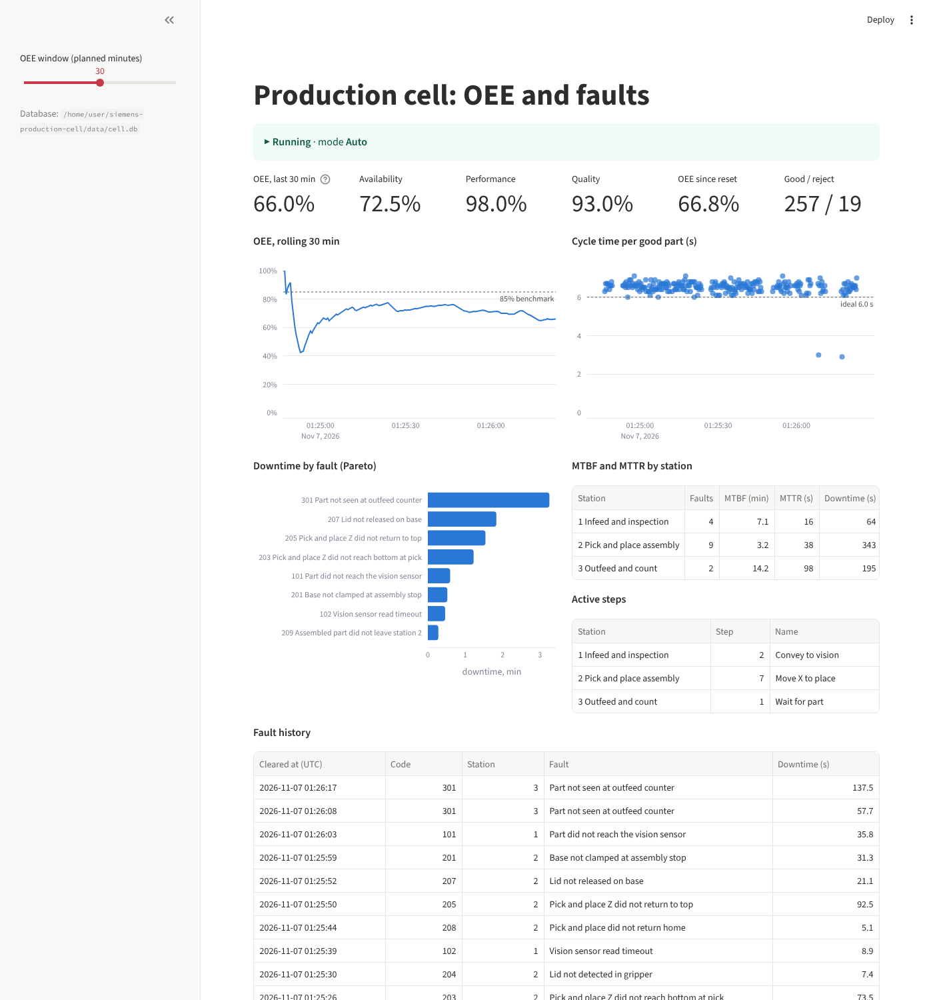

---
hide:
  - navigation
  - toc
---

<div class="hero" markdown>
<p class="eyebrow">Independent project · Industrial automation · Nov 2026 – now</p>

# Siemens S7-1500 Production Cell + OEE Dashboard

<p class="pitch">A three-station simulated assembly cell run by an S7-1500, programmed with SICAR-style S7-GRAPH step sequences, operated from a WinCC HMI and connected over OPC UA to a live OEE dashboard.</p>
<p class="meta">Factory I/O · PLCSIM Advanced · TIA Portal · OPC UA · Python / Streamlit</p>
<p class="tag-row"><span>S7-1500</span><span>S7-GRAPH</span><span>SCL</span><span>WinCC</span><span>OPC UA</span><span>Factory I/O</span><span>Streamlit</span><span>SQLite</span></p>

[Cell design](design/cell-and-io.md){ .md-button .md-button--primary } [Dashboard](software/dashboard.md){ .md-button } [:fontawesome-brands-github: View source files](https://github.com/LakshanandSugumar/siemens-production-cell){ .md-button }
</div>

<div class="lp-media" markdown>

<p class="cap">The OEE dashboard running live against the mock S7-1500.</p>
</div>

<div class="stat-row">
  <div class="stat"><span class="num">3</span><span class="label">Stations in the cell</span></div>
  <div class="stat"><span class="num">3</span><span class="label">Modes: Auto / Manual / Setup</span></div>
  <div class="stat"><span class="num">5</span><span class="label">WinCC HMI screens</span></div>
  <div class="stat"><span class="num">10</span><span class="label">Automated tests incl. end-to-end OPC UA</span></div>
</div>


## Why this project

Production cells in automotive and assembly plants are programmed in a very particular way: step sequences with explicit interlocks and step supervision (the SICAR style), clear operating modes, an HMI that tells the operator *why* something is blocked, and production data flowing up to MES for OEE. I worked with Allen-Bradley and Siemens PLCs in industry; this project builds a complete Siemens cell end to end, in the open, from the I/O list to the OEE numbers.

## Architecture


```
Factory I/O scene  <── PLCSIM Advanced driver ──>  S7-1500 (PLCSIM Advanced)
                                                     ├─ FB_ModeManager
                                                     ├─ GR_Station1..3  (S7-GRAPH)
                                                     ├─ FB_Production  -> DB_Production
                                                     │
                                       WinCC HMI ◄───┤  (Profinet / HMI connection)
                                                     │
                                                     └─ OPC UA server
                                                            │
                                     python/dashboard/collector.py  -> SQLite
                                                            │
                                     python/dashboard/app.py (Streamlit): OEE, Pareto, MTBF/MTTR
```

Until the PLC exists, `python/cellsim/server.py` stands in for it: it runs the same three sequences, publishes the same OPC UA node ids under the Siemens namespace URI, and accepts the same HMI commands. Switching the dashboard to the real PLC is a URL change.

Until the PLC project exists, a mock S7-1500 OPC UA server stands in for it: it runs the same three sequences, publishes the same node ids under the Siemens namespace URI and accepts the same HMI commands. Switching the dashboard to the real PLC is a URL change.

## Status


| Part | State |
| --- | --- |
| Cell design, I/O list, GRAPH step specs, modes and interlocks, HMI spec | Done (`docs/`) |
| OPC UA interface contract | Done (`docs/05_opcua_interface.md`) |
| Mock S7-1500 OPC UA server with the cell simulated | Done and tested (`python/cellsim`) |
| OPC UA collector, OEE maths, Streamlit dashboard | Done and tested (`python/dashboard`) |
| SCL for DBs, mode manager, production counters | Drafted, not yet compiled in TIA (`plc/scl`) |
| TIA Portal project, GRAPH sequences, WinCC screens, Factory I/O scene | Planned Dec 14 to Jan 3 (`docs/06_tia_build_plan.md`) |
| Video | After the TIA build |


## Explore

<div class="grid cards" markdown>

-   :material-factory: **[Cell design & I/O](design/cell-and-io.md)**

    Stations, part flow, Factory I/O scene and the full I/O list with addresses.

-   :material-stairs: **[S7-GRAPH sequences](design/sequences.md)**

    Step tables for all three stations: actions, transitions, interlocks, supervision and fault codes.

-   :material-shield-lock-outline: **[Modes & interlocks](design/modes-and-interlocks.md)**

    Auto / Manual / Setup, E-stop, stack light, jog interlocks and the alarm strategy.

-   :material-monitor-dashboard: **[HMI spec](design/hmi.md)**

    Five WinCC screens and the colour and command rules behind them.

-   :material-lan-connect: **[OPC UA interface](design/opcua.md)**

    Every published tag with node id, type and access, and the fault event pattern.

-   :material-chart-line: **[Dashboard & data](software/dashboard.md)**

    Collector, SQLite schema, OEE and MTBF / MTTR definitions, sample run.

</div>

## Demo script (planned video, 3–4 min)


1. Cell overview on the HMI, Auto, Start. Parts flow; the dashboard OEE rises.
2. Force `S1_PusherFront` off in Factory I/O. GRAPH supervision trips fault 103 after 2 s; HMI alarm and station screen show the blocked step; stack light red.
3. Stop, switch to Manual. Show a jog blocked by its interlock, with the reason on screen.
4. Release the force, Reset, Auto, Start. The dashboard shows the downtime in the Pareto and the MTTR.

<div class="lp-cta" markdown>
## Want to go deeper?

<p>Read the full write-up, browse the source, or see the rest of my work.</p>

[:fontawesome-brands-github: View source files](https://github.com/LakshanandSugumar/siemens-production-cell){ .md-button .md-button--primary } [All projects](https://lakshanandsugumar.github.io/projects/){ .md-button } [Portfolio](https://www.lakshanand.dev){ .md-button }
</div>
