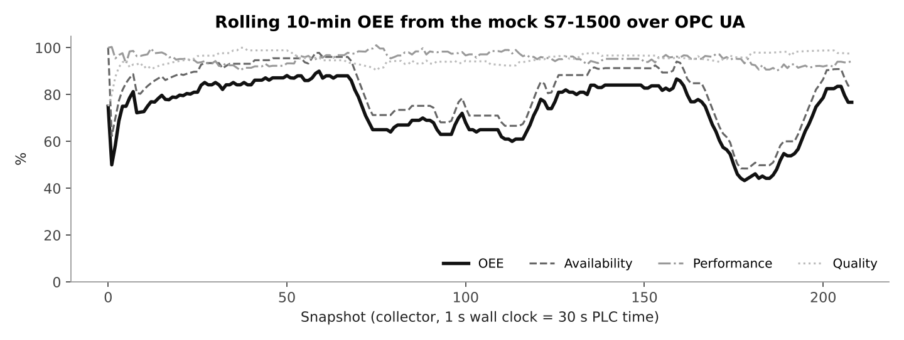
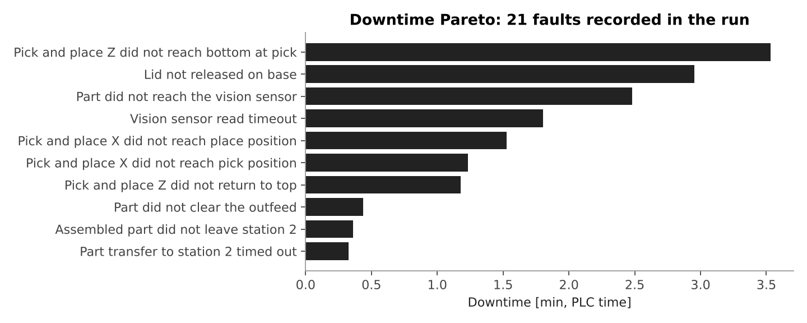
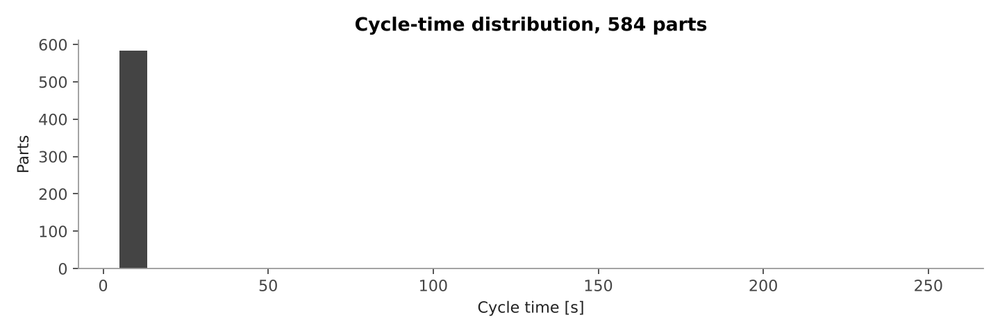
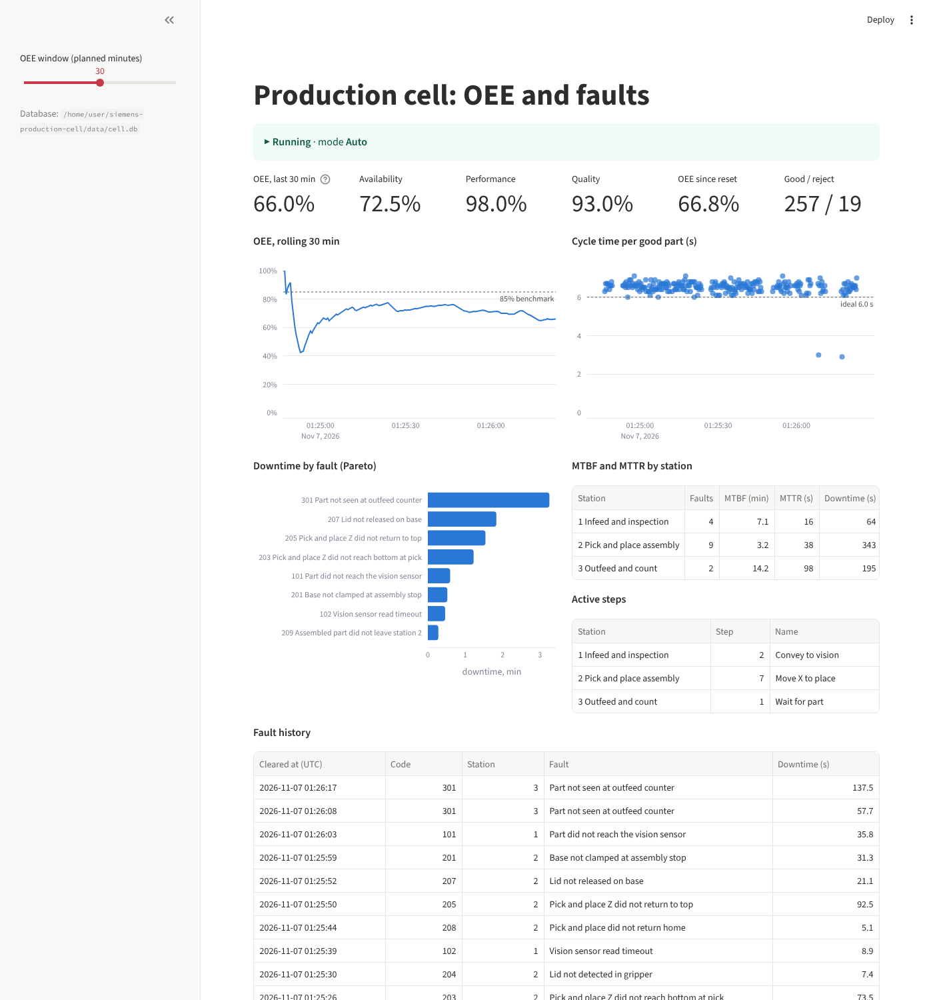

# Simulation Run

A recorded run of the full data path: the **mock S7-1500 OPC UA server** running all three stations at 30× real time, the **OPC UA collector** writing to SQLite, and the OEE maths from the dashboard. During the run a station-2 jam was injected by hand, and the cell was stopped and restarted the way an operator would from the HMI. Random jams were also enabled in the simulator.

<div class="stat-row">
  <div class="stat"><span class="num">~79 min</span><span class="label">Planned production time (PLC time)</span></div>
  <div class="stat"><span class="num">615</span><span class="label">Parts made, 589 good</span></div>
  <div class="stat"><span class="num">73%</span><span class="label">OEE over the whole run</span></div>
  <div class="stat"><span class="num">21</span><span class="label">Faults recorded, mean 45 s to clear</span></div>
</div>

| OEE factor | Value | What it measures |
| --- | ---: | --- |
| Availability | 80.1% | Run time ÷ planned time: lost to jams and the stop |
| Performance | 95.2% | Ideal 6.0 s cycle × parts ÷ run time |
| Quality | 95.7% | Good parts ÷ total parts |
| **OEE** | **73.0%** | Availability × Performance × Quality |

## Rolling OEE



Each dip in availability is a jam or the operator stop; OEE recovers as the cell runs clean again.

## Downtime Pareto



The same view a maintenance team uses to decide which fault to fix first.

## Cycle time



## Dashboard



## Reproduce

```bash
cd python
pip install -r requirements.txt
python -m cellsim.server --speed 30 --seed 7     # terminal 1: mock PLC
python -m dashboard.collector --db ../data/cell.db --period 1   # terminal 2
python -m cellsim.cmd inject 2                   # jam station 2
python -m cellsim.cmd stop && python -m cellsim.cmd start
streamlit run dashboard/app.py                   # view it live
```

All numbers on this page come from that recorded run, not from the real PLC. The TIA Portal build comes next.
