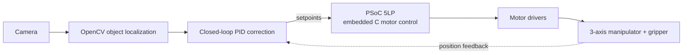

EGR 456 · Spring 2026 · ASU Polytechnic

# Vision-Guided 3-Axis Pick-and-Place

A three-axis robotic manipulator that finds objects with a camera and picks and places them on its own, with real-time motor control in embedded C on a PSoC 5LP.

PSoC 5LPEmbedded COpenCVPIDMotor control

[Results](#results){ .md-button .md-button--primary } [System design](#system-design){ .md-button }

  
92.5%Success rate (74 / 80 trials)

  
±2.5 mmPositioning accuracy

  
±1.0 mmRepeatability

  
4.8 sMean cycle time

## System design

| Layer | What I did |
| --- | --- |
| Vision | Object localization in OpenCV to find each target in the workspace |
| Control | Closed-loop PID correction that compensates positioning error while grasping |
| Embedded | Real-time motor control written in embedded C on the PSoC 5LP |
| Hardware | Integrated motor drivers, sensors and control hardware; board-level bring-up and I/O validation |
| Verification | End-to-end system tests over the full workspace |

## Results

80 autonomous pick-and-place trials across a **350 × 200 × 150 mm** workspace:

| Metric | Result |
| --- | --- |
| Successful picks | **74 / 80 (92.5%)** |
| Positioning accuracy | ±2.5 mm |
| Repeatability | ±1.0 mm |
| Mean cycle time | 4.8 s per pick-and-place |

Repeatability is tighter than accuracy, which points to a systematic offset rather than random error: the arm lands in the same place each time, a little away from the target. That makes camera-to-arm calibration the clearest next improvement.

## Skills used

PSoC 5LP · PSoC Creator · embedded C · OpenCV · PID tuning · motor drivers · hardware bring-up · system verification

!!! note "Source code"
    The code and design files for this project are not public yet. This page documents what was built and measured.
