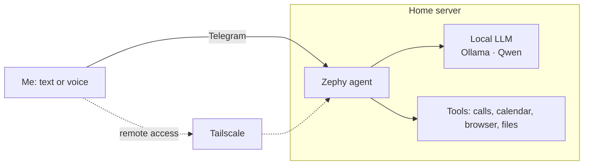

Personal project · AI assistant · 9th upgrade

# Zephy

My personal voice assistant. It started as a local assistant on an Ollama / Qwen backend and is now a Jarvis-style agent on my own machine that can place calls, schedule meetings and work on projects with me and others.

Local LLMOllamaQwenVoice assistantTelegramTailscale

[Architecture](#architecture){ .md-button .md-button--primary } [Evolution](#evolution){ .md-button }

## What Zephy does

- Places calls and schedules meetings
- Works on projects with me and with other people
- Runs locally on hardware I own, with no paid API keys

## Architecture

| Piece | Choice |
| --- | --- |
| Host | ASUS Zephyrus G14 (32 GB RAM, RTX 4070) converted into a 24/7 home AI server |
| Model backend | Local models via Ollama (Qwen family) |
| Interface | Messaging through Telegram, voice on the machine |
| Remote access | Tailscale |
| Wake behaviour | Sleeps until messaged; a light heartbeat checks email and only pings me when something matters |

## Evolution

Zephy began as a local assistant answering questions on an Ollama / Qwen backend. Nine upgrades later it is an agent that takes actions: calls, scheduling and project work, from anywhere.

## Next

- Move the home server from Windows to Ubuntu
- Shared memory and tool layer so every assistant I use sees the same knowledge
- Edge hardware (Jetson) for always-on, low-power operation
